# Lab D00: Docker Foundations: Why Containers Exist and How Docker Really Works

> ⏱ 2.5–3 hours · 🟢 Absolute beginner: no IT background needed · 🧪 hands-on parts need Docker ([setup](../../00-setup/README.md))

By the end of this module you will be able to explain, **in your own words and without notes**:

- why Docker was invented, and what was painful before it
- what "containerization" actually means, and why the industry adopted it
- how a container differs from a virtual machine
- what really happens, component by component, when you type `docker run`
- what images, containers, layers, namespaces and cgroups are

Every concept follows the same rhythm:

> **Explain** in plain words → **Illustrate** with a picture → **Relate** it to everyday life → **Map** it to the real technology → **Prove it** with a command → **Quick check** ⚡

<details><summary>📑 Contents</summary>

1. [The problem before Docker](#1-the-problem-before-docker)
2. [Containerization in one sentence](#2-containerization-in-one-sentence)
3. [How we got here: the evolution of deployment](#3-how-we-got-here-the-evolution-of-deployment)
4. [Virtual machines vs containers](#4-virtual-machines-vs-containers)
5. [Docker architecture, explained as a restaurant](#5-docker-architecture-explained-as-a-restaurant)
6. [What happens when you type `docker run nginx`](#6-what-happens-when-you-type-docker-run-nginx)
7. [Inside a container: namespaces, cgroups and layers](#7-inside-a-container-namespaces-cgroups-and-layers)
8. [Images vs containers](#8-images-vs-containers)
9. [How images travel: registries](#9-how-images-travel-registries)
10. [Your first 12 commands, explained](#10-your-first-12-commands-explained)
11. [Myths, busted](#11-myths-busted)
12. [Recap, the final challenge, and the quiz](#12-recap-the-final-challenge-and-the-quiz)
</details>

---

## 1. The problem before Docker

### Story 1: the phone that arrived broken 📱

You order a brand-new phone online. Two different sellers ship the **same phone**.

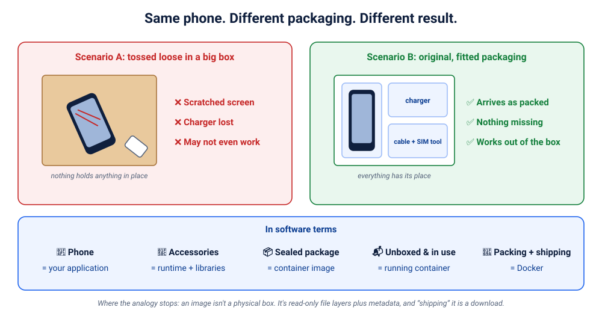

- **Seller A** drops it, loose, into a big cardboard box. No bubble wrap, no tray. It slides around for three days. It arrives scratched, the charger is missing, and it might not even switch on.
- **Seller B** ships it in its original fitted packaging: a tray for the phone, slots for the charger and cable, everything held in place. It arrives **exactly as it left the factory**.

So, what made the difference? Not the phone, and not the delivery driver. **The packaging made the difference.** Good packaging makes delivery *predictable*.

Now swap the phone for software:

| Everyday world | Software world |
|---|---|
| 📱 The phone | Your **application** (code) |
| 🔌 Charger, cable, SIM tool | Its **runtime and libraries**: Python 3.11, Flask, system libraries, config files |
| 📦 The sealed, fitted package | A **container image**: the app *plus everything it needs to run*, sealed together |
| 📬 The phone unboxed and switched on | A **container**: the image, actually running |
| 🚚 The packing and shipping system | **Docker**: the tools that build, ship and run those packages |

> 🧠 **The one sentence to remember:**
> **Don't just ship the application. Ship the application with everything it needs to run.**

⚠️ *Where the analogy stops:* an image is not a physical box. It is a set of **read-only file layers plus metadata** (which command to run, which port, which environment variables). "Shipping" it means uploading and downloading files. Keep the intuition, and drop the cardboard.

### Story 2: "It works on my machine!" 🤷

A conversation that has happened in every software company on Earth:

> 👩‍💻 **Developer:** It works perfectly on my laptop!
> 🧪 **Tester:** It crashes on my machine.
> 👩‍💻 **Developer:** Impossible. I tested it yesterday!
> 🛠️ **Operations engineer:** It doesn't even *start* in production.
> 👩‍💻 **Developer:** Then maybe your server just doesn't like my application. 🙃

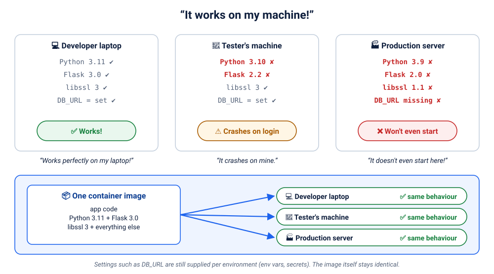

Here's what was really going on. The app needs **Python 3.11, Flask 3.0, OpenSSL 3, and an environment variable `DB_URL`**:

| | Python | Flask | libssl | `DB_URL` | Result |
|---|---|---|---|---|---|
| 💻 Developer laptop | 3.11 | 3.0 | 3 | set | ✅ works |
| 🧪 Tester's machine | 3.10 | 2.2 | 3 | set | ⚠️ crashes on login (Flask API changed) |
| 🏭 Production server | 3.9 | 2.0 | 1.1 | missing | ❌ won't start |

Nobody was lying. **The code was the same; the environments were not.** Before containers, teams wrote 40-page "installation guides", hoped every server was set up identically, and spent days on "environment drift".

**What Docker changes:** the app ships *together with* Python 3.11, Flask 3.0 and its libraries, as one image. The laptop, the tester and the production server all run **the same image**. Only genuine settings such as `DB_URL` differ, and they're passed in from outside (you'll do exactly this in Lab D04).

### ⚡ Quick check
<details><summary>1. In the phone story, which part is the "image" and which is the "container"?</summary>

The sealed, fitted package is the **image** (everything packed, nothing running). The phone unboxed and switched on is the **container** (the package in use).
</details>
<details><summary>2. Does Docker remove the need for configuration like <code>DB_URL</code>?</summary>

No. Docker packages the app and its *dependencies*. Settings that differ per environment (database addresses, passwords) are still supplied from outside, through environment variables, config files or secrets, so that the same image can run everywhere.
</details>

---

## 2. Containerization in one sentence

> **Containerization** means packaging an application together with everything it needs (its runtime, libraries and files) into a standard unit that runs **isolated** from other software but **shares the host computer's operating-system kernel**.

Three words carry all the meaning:

| Word | Meaning | Why it matters |
|---|---|---|
| **Packaged** | app + dependencies in one image | the same thing runs everywhere |
| **Isolated** | each container has its own files, processes and network view | apps can't break each other |
| **Shared kernel** | no full operating system per app | small, fast to start, efficient |

You'll understand each word deeply by the end of chapter 7.

---

## 3. How we got here: the evolution of deployment

### First, why are they called "containers"? 🚢

Before 1956, ships were loaded **by hand**: sacks of rice, barrels of oil, crates of machinery, each a different shape and each handled differently. Loading one ship could take a week, and goods were often damaged or stolen.

Then trucking entrepreneur **Malcom McLean** shipped goods in **standard steel boxes**. Every port, crane, truck and train could handle *any* box the same way, without caring what was inside. Global trade exploded.

Software containers borrowed the idea and the name: **a standard box for software**, so that every laptop, server and cloud can run it the same way without caring what's inside.

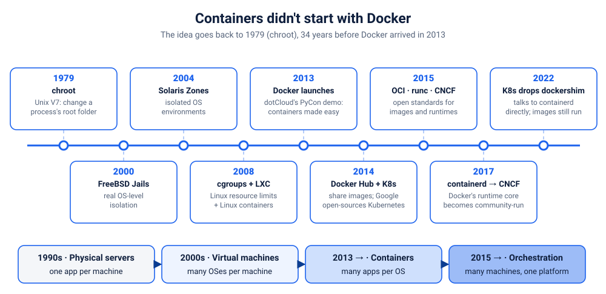

### Era 1: physical servers (1990s–2000s) 🏚️
**One application per physical server.** If you had a web app, a database and a reporting tool, you bought three servers.

- 💸 Expensive: each server costs money, power, space and cooling.
- 😴 Wasteful: most servers sat at 5–15% CPU usage. (That's a common industry rule of thumb, not a law.)
- 🐢 Slow: getting a new server could take weeks (order, deliver, rack, install).
- 💥 Conflicts: put two apps on one server and they fight over library versions and ports.

> 🏠 *Like buying an entire house just to use one bedroom.*

### Era 2: virtual machines (2000s) 🧱
A **hypervisor** (VMware, Hyper-V, KVM, Xen) splits one physical server into several **virtual machines**. Each VM pretends to be a complete computer, with **its own operating system**.

- ✅ Much better hardware use: 10–20 VMs on one server
- ✅ Strong isolation: a crash in one VM doesn't affect another
- ❌ Every VM carries a **full guest OS**: often gigabytes of disk, its own memory, its own patching and boot time
- ❌ "Works on my machine" still happens *inside* the VMs

> 🏢 *Like an apartment complex where every family has a fully independent flat, with its own kitchen, bathroom, water tank and electricity meter.*

### Era 3: containers (OS-level isolation) 📦
Instead of virtualising **hardware**, containers isolate **processes** using features built into the Linux kernel. Every container shares the host's kernel but gets its own private view of files, processes and network.

- ✅ No guest OS to boot, so containers typically start in **about a second**
- ✅ Images are often **megabytes**, not gigabytes
- ✅ Dozens or hundreds of containers per machine

> 🏢 *Like apartments in one building: private flats, but a shared foundation, water mains and electrical supply.*

### Era 4: Docker changes the game (2013) 🐳
**Important history:** Docker did **not** invent containers. The building blocks are decades old:

| Year | Technology | What it gave us |
|---|---|---|
| 1979 | `chroot` (Unix V7) | give a process its own "root" folder |
| 2000 | FreeBSD **Jails** | isolated mini-systems on one OS |
| 2004 | Solaris **Zones** | isolated OS environments |
| 2002–2013 | Linux **namespaces** | isolate what a process can *see* |
| 2008 | Linux **cgroups** (from Google engineers) | limit what a process can *use* |
| 2008 | **LXC** (Linux Containers) | combined both into usable containers |

So what *did* Docker do? In **March 2013**, Solomon Hykes of the platform company **dotCloud** demoed Docker at PyCon and open-sourced it. dotCloud soon renamed itself **Docker, Inc.** Docker made containers **easy and portable** for ordinary developers:

- 📄 **Dockerfile**: a simple text recipe for building an image
- 🖼️ **Images**: layered, versioned, shareable packages
- ☁️ **Docker Hub** (2014): an online library of ready-made images
- ⌨️ **One CLI**: `docker build`, `docker push`, `docker run`, the same on every machine

Containers went from "a Linux kernel expert's tool" to "something every developer uses daily".

### Era 5: the modern container ecosystem (2015 → today) 🌐
As containers took over, the industry standardised the pieces so nobody depended on one company:

- **OCI** (Open Container Initiative, 2015): open standards for the **image format** and the **runtime**. An image built by Docker runs on any OCI-compliant runtime.
- **runc**: the small, low-level tool that actually creates containers. Docker donated it to the OCI.
- **containerd**: the runtime that manages container lifecycles. Docker split it out and donated it to the **CNCF** in 2017; Kubernetes and Docker both use it today.
- **Kubernetes** (open-sourced 2014, v1.0 in 2015): runs containers across **many** machines. That's Track 2 of this course.
- **Cloud native**: apps designed as many small, independently deployable containerised services.

### ⚡ Quick check
<details><summary>1. Did Docker invent containers?</summary>

No. chroot (1979), FreeBSD Jails (2000), Solaris Zones (2004), Linux namespaces, cgroups and LXC (2008) all came first. Docker **popularised** containers by making them simple and portable: Dockerfiles, layered images, Docker Hub and one consistent CLI.
</details>
<details><summary>2. What problem did VMs solve, and which one did they leave?</summary>

VMs solved *hardware waste* by putting many isolated machines on one server. They didn't solve *packaging*: each VM still needs a full OS and still suffers from "works on my machine" inside it. And each one carries the overhead of a whole guest OS.
</details>

---

## 4. Virtual machines vs containers

This is the most important comparison in the whole course. Take your time here.

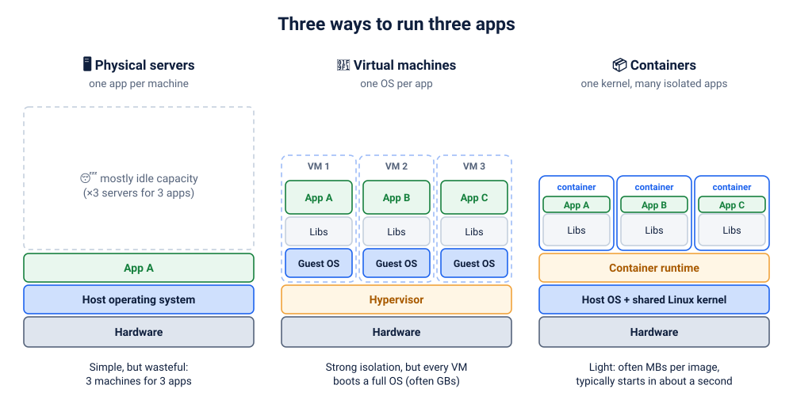

### The house vs apartment analogy

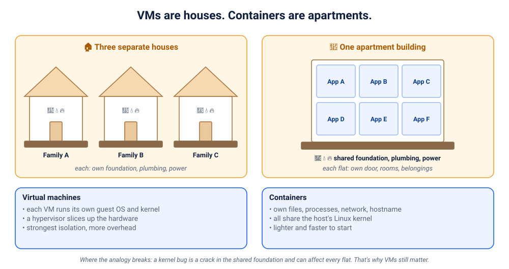

**Virtual machines are separate houses.** Each house has its own foundation, plumbing, electrical wiring and water tank. If your neighbour's pipes burst, your house is fine. But building every house from scratch is slow and uses a lot of land.

Each **VM** similarly has its own virtual hardware, **its own complete guest operating system and kernel**, its own libraries and the app. The hypervisor keeps them apart.

**Containers are apartments in one building.** Each family has a private flat: its own door, rooms, furniture and doorbell name. But all flats share the building's **foundation, water mains and power supply**.

Each **container** similarly has its own isolated processes, filesystem, network and hostname, but **all containers share the host's Linux kernel**.

| Feature | Virtual machine | Container |
|---|---|---|
| Operating system | full guest OS with its own kernel | shares the host's kernel |
| Typical size | gigabytes | megabytes to hundreds of MB |
| Typical startup | tens of seconds to minutes (an OS boots) | well under a second to a few seconds (a process starts) |
| Isolation boundary | hardware virtualisation (hypervisor) | OS-level (namespaces + cgroups) |
| Resource overhead | higher: every VM runs a whole OS | lower: just your app's processes |
| Portability unit | VM disk images (VMDK, VHD, QCOW2…) | OCI container images |
| Typical use | different OSes (e.g. Windows on a Linux host), strong multi-tenant isolation, legacy apps | microservices, packaging apps, CI, fast scaling |

> These are **general characteristics, not guarantees**. A tiny VM can boot fast, and a badly built container image can be huge.

### 🔬 Prove the "shared kernel" with your own eyes
Run two containers from **completely different Linux distributions** and ask each one which kernel it's using:
```bash
docker run --rm alpine grep PRETTY /etc/os-release
docker run --rm ubuntu:24.04 grep PRETTY /etc/os-release
docker run --rm alpine uname -r
docker run --rm ubuntu:24.04 uname -r
```
Example output (yours will differ):
```
PRETTY_NAME="Alpine Linux v3.24"
PRETTY_NAME="Ubuntu 24.04.5 LTS"
7.0.12-linuxkit
7.0.12-linuxkit
```
🤯 **Different distributions, exactly the same kernel.** Alpine and Ubuntu bring their own *files* (shell, libraries, package manager), but they run on the **one kernel** of the host.

> 🍎 **On macOS and Windows**, Docker Desktop quietly runs a small **Linux VM** (that's the `-linuxkit` kernel), and all your containers share *its* kernel. So containers and VMs are **teammates, not rivals**. In the cloud, containers usually run inside VMs too.

### When would you still choose a VM?
- you need a **different kernel or OS**: Windows software, an old Linux kernel, a kernel module
- you run **untrusted code from different customers** and need the strongest isolation (some platforms use lightweight "micro-VMs" such as Firecracker or Kata Containers to get both)
- legacy software that expects a whole machine

⚠️ *Where the apartment analogy breaks:* a kernel bug is a **crack in the shared foundation**: it can affect every flat. That's why containers are hardened (non-root users, dropped capabilities, seccomp; see Lab D11) and why VMs still matter.

### ⚡ Quick check
<details><summary>1. A container shows "Ubuntu 24.04", yet <code>uname -r</code> prints the host's kernel. How?</summary>

The container brings Ubuntu's **files** (its userland: shell, libraries, apt), but there is no Ubuntu kernel inside. Every container uses the host's kernel. That is the core difference from a VM.
</details>
<details><summary>2. Can a Linux container run a Windows <code>.exe</code> natively?</summary>

No. Containers share the host kernel, and a Linux kernel can't run Windows binaries natively. You'd need a Windows host (Windows containers) or a VM.
</details>

---

## 5. Docker architecture, explained as a restaurant

Forget the jargon for a moment. Picture a restaurant.

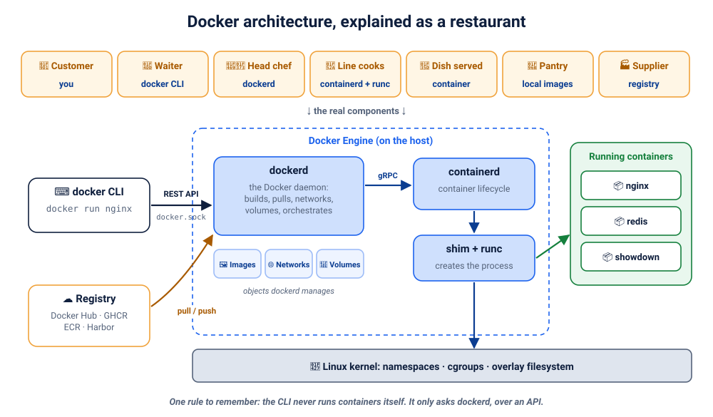

1. 🧑 **You (the customer)** decide what you want: "one nginx, please."
2. 📝 **The waiter** writes it down and takes it to the kitchen. The waiter doesn't cook.
3. 👩‍🍳 **The head chef** checks the pantry, orders missing ingredients from the supplier, and tells the cooks what to make.
4. 🔪 **The line cooks** do the actual cooking at the stove.
5. 🍝 **The dish** arrives at your table: your order, now real.
6. 🥫 **The pantry** keeps ingredients ready for next time, and 🏭 **the supplier** delivers whatever the pantry is missing.

| Restaurant | Docker | What it really is |
|---|---|---|
| 🧑 Customer | **You** | typing commands in a terminal |
| 📝 Waiter | **Docker CLI** (`docker`) | a client program that turns your command into an API request |
| 👩‍🍳 Head chef | **Docker daemon** (`dockerd`) | a background service that does the real work |
| 🔪 Line cooks | **containerd + runc** | the runtimes that actually create and supervise containers |
| 🍝 Dish served | **Container** | a running, isolated process |
| 🥫 Pantry | **Local image store** | images already downloaded to this machine |
| 🏭 Supplier | **Registry** (e.g. Docker Hub) | an online store of images |

### The components, one by one

**1. Docker client (CLI): the waiter.** The `docker` command you type. It **never runs containers itself**: it converts `docker run nginx` into an HTTP API call and shows you the response. That's why the CLI can even talk to a Docker engine on another computer (`docker context`, `DOCKER_HOST`).

**2. Docker daemon (`dockerd`): the head chef.** A long-running background service. It receives API requests and manages everything: building images, pulling and pushing them, creating networks and volumes, and asking the runtime to start containers. If `dockerd` isn't running, you get the famous *"Cannot connect to the Docker daemon"*.

**3. Docker Engine: the whole kitchen.** The name for the server-side package: `dockerd` plus its API, together with **containerd** and **runc**. "Is Docker Engine installed?" means "is the server side there?"

**4. Docker REST API: the order slip.** The language the CLI and daemon speak: plain HTTP requests like `POST /containers/create`. On Linux it usually listens on a **Unix socket**, `/var/run/docker.sock`; on Docker Desktop for Mac it lives at `~/.docker/run/docker.sock`.
> 🔐 Anyone who can talk to `docker.sock` effectively has **root on the host**. Never expose it carelessly.

**5. containerd: the kitchen supervisor.** An industry-standard container runtime (a graduated CNCF project). It manages the container **lifecycle**: preparing filesystem snapshots, starting and stopping containers, and, in newer Docker versions, storing images. Kubernetes uses containerd directly, too.

**6. runc: the cook at the stove.** A small, low-level tool, the OCI reference runtime. It talks directly to the Linux kernel: "create these namespaces, apply these cgroup limits, mount this filesystem, start this process". Once the container is running, **runc exits**. A tiny **shim** process stays behind as the container's parent.

**7. Images: the ingredients and recipe, sealed.** Read-only templates: a stack of filesystem layers plus metadata (default command, environment, exposed ports). Chapter 8 goes deeper.

**8. Containers: the dish.** A running (or stopped) instance of an image: real processes on the host, isolated by namespaces, limited by cgroups, with a thin writable layer on top of the image.

**9. Registries: the supplier's warehouse.** Servers that store and distribute images: Docker Hub, GitHub Container Registry (GHCR), Amazon ECR, Google Artifact Registry, Azure ACR, or a self-hosted Harbor.

**10. Docker Hub: the most famous supplier.** Docker's public registry. When you type `nginx`, Docker reads it as `docker.io/library/nginx:latest`.

**11. Docker networks: the restaurant's internal phone system.** Virtual networks that let containers talk to each other by name, isolated from other groups of containers (Lab D07).

**12. Docker volumes: personal lockers.** Storage that lives **outside** a container's lifecycle. Delete the container and the volume (your data) stays, like a locker you keep after you move out (Lab D06).

### 🔬 See the architecture on your own machine
```bash
docker version            # TWO sections: Client (the waiter) and Server (the kitchen)
docker version --format '{{range .Server.Components}}{{.Name}}={{.Version}}  {{end}}'
docker info --format 'storage={{.Driver}}  runtime={{.DefaultRuntime}}  cgroups=v{{.CgroupVersion}}'
docker context ls         # which engine is your CLI talking to?
```
Example:
```
Engine=29.7.2  containerd=v2.3.3  runc=1.4.3  docker-init=0.19.0
storage=overlayfs  runtime=runc  cgroups=v2
```
There they are: **Engine (dockerd), containerd and runc**, three separate components with three separate version numbers.

### ⚡ Quick check
<details><summary>1. You type <code>docker ps</code> and get "Cannot connect to the Docker daemon". Which component is missing?</summary>

The **daemon** (`dockerd`) isn't running or isn't reachable. The client (CLI) works fine: it printed the error. Start Docker Desktop, or run `sudo systemctl start docker` on Linux.
</details>
<details><summary>2. Are Docker Engine, containerd and runc the same thing?</summary>

No. `dockerd` (Docker Engine's daemon) handles the API, images, networks, volumes and builds. **containerd** manages container lifecycles. **runc** creates the actual container process via the kernel, then exits. They're layered: dockerd → containerd → runc → kernel.
</details>

---

## 6. What happens when you type `docker run nginx`

One short command sets off an impressive chain reaction:

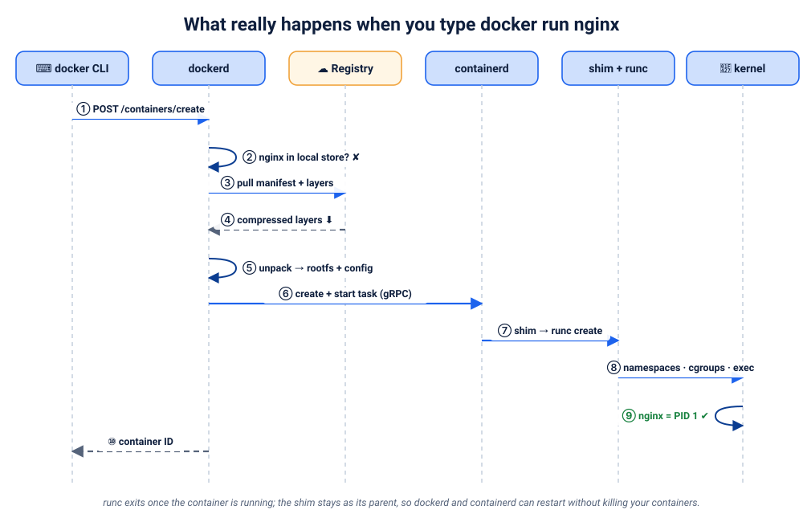

| Step | Who | What happens |
|---|---|---|
| ① | **CLI** | parses `docker run nginx`, expands `nginx` to `docker.io/library/nginx:latest`, sends `POST /containers/create` to the daemon over `docker.sock` |
| ② | **dockerd** | checks the **local image store**: is `nginx:latest` already here? |
| ③ | **dockerd → registry** | if not: downloads the image **manifest** (the list of layers for your CPU type: amd64 or arm64) |
| ④ | **registry → dockerd** | sends each missing **layer** (compressed); layers you already have are skipped |
| ⑤ | **dockerd / containerd** | unpacks the layers into a **snapshot** and adds a thin writable layer on top; prepares the container's config (command, env, ports, network, limits) |
| ⑥ | **dockerd → containerd** | "create this container and start its task" (via gRPC) |
| ⑦ | **containerd → shim → runc** | containerd starts a small **shim** process, which calls **runc** |
| ⑧ | **runc → Linux kernel** | creates **namespaces** (PID, network, mount, UTS, IPC…), applies **cgroup** limits, mounts the filesystem, then **executes** nginx's start command |
| ⑨ | **kernel** | nginx is now running as **PID 1** inside its own namespaces; runc exits, and the shim stays as nginx's parent |
| ⑩ | **dockerd → CLI** | returns the container ID (with `-d`) or streams the logs to your terminal |

> 🧠 Why the shim? Because the shim (not dockerd) is the container's parent process, **dockerd and containerd can be restarted or upgraded without killing your running containers**.

### 🔬 Watch it happen
```bash
docker rmi nginx:1.27-alpine 2>/dev/null        # start from a clean slate
docker run -d --name demo nginx:1.27-alpine
```
You'll see `Unable to find image … locally`, then `Pulling from library/nginx`, one line per **layer**, `Digest: sha256:…`, and finally the **container ID**. Every one of those lines is a step in the table above.
```bash
docker run -d --name demo2 nginx:1.27-alpine    # instant: steps ③–④ are skipped, the image is cached
docker rm -f demo demo2
```

### ⚡ Quick check
<details><summary>Why was the second <code>docker run</code> almost instant?</summary>

The image was already in the local image store, so no download was needed (steps ③ and ④ were skipped). Creating a container from a cached image only takes namespaces, cgroups and a thin writable layer: milliseconds of work.
</details>

---

## 7. Inside a container: namespaces, cgroups and layers

A container is not a magic box. It is **an ordinary Linux process** that the kernel has given:
1. **blinkers**, so it sees only its own world: **namespaces**
2. **a budget**, so it can use only its share: **cgroups**
3. **a layered filesystem**, so it gets its own files cheaply: **union filesystem / overlayfs**

### 7.1 Namespaces: what a container can *see* 👀

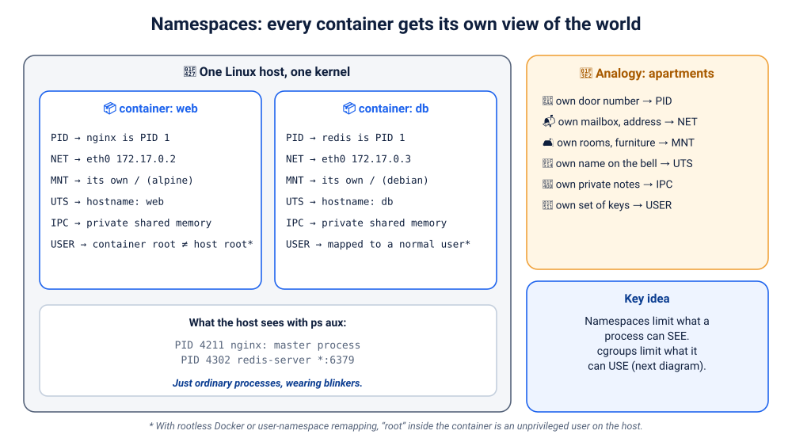

**Analogy.** In an apartment building, every flat has its own door number, mailbox, rooms, name on the bell and keys. You can't see into your neighbour's flat, even though you share the building.

**Technical.** A **namespace** wraps a global system resource so that processes inside it see their own private copy:

| Namespace | Isolates | Apartment analogy | In a container |
|---|---|---|---|
| **PID** | process IDs | own door numbering | the app is **PID 1**; host processes are invisible |
| **NET** | network interfaces, IPs, ports, routes | own mailbox and address | own `eth0` and IP; port 80 can be used by many containers at once |
| **MNT** | mounted filesystems | own rooms and furniture | own `/` root filesystem from the image |
| **UTS** | hostname | own name on the bell | own hostname |
| **IPC** | shared memory, message queues | own private notes | can't read other containers' shared memory |
| **USER** | user and group IDs | own set of keys | with user-namespace remapping or rootless Docker, "root" inside maps to an unprivileged user outside |
| *(cgroup)* | the view of the cgroup tree | | the container sees its own cgroup as the top |

🔬 **Prove it:**
```bash
docker run --rm alpine ps                                # PID namespace
```
```
PID   USER     TIME  COMMAND
    1 root      0:00 ps
```
The *only* process the container can see is itself, and it believes it's PID 1.
```bash
docker run --rm --hostname kitchen alpine hostname      # UTS namespace → kitchen
docker run -d --name web nginx:1.27-alpine
docker top web                                           # the SAME processes, seen from the host
```
```
UID    PID    PPID   ...   CMD
root   2565   2539   ...   nginx: master process nginx -g daemon off;
```
Inside, nginx is PID 1. From the host it's PID 2565. **Same process, two views.** That's a namespace.

### 7.2 cgroups: what a container can *use* 🧮

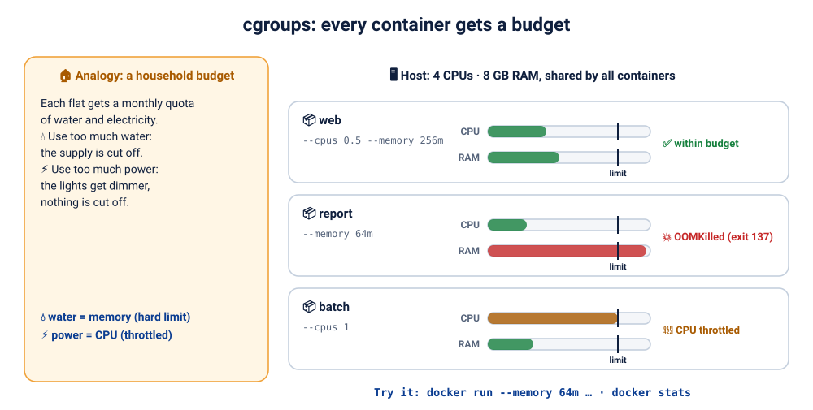

**Analogy.** Each flat gets a monthly quota. Use too much **water** and the supply is cut off. Use too much **power** and the lights dim, but nothing is cut off.

**Technical.** **Control groups (cgroups)** let the kernel **limit and account for** the resources a group of processes uses: CPU, memory, disk I/O, number of processes.

| Resource | Flag | When exceeded |
|---|---|---|
| Memory | `--memory 256m` | the process is **killed** (OOMKilled, exit code 137), like the water being cut off |
| CPU | `--cpus 0.5` | the process is **throttled**: it runs slower, like dimmed lights |
| Processes | `--pids-limit 100` | new processes can't be created (stops "fork bombs") |

🔬 **Prove it.** Ask the kernel what budget it set:
```bash
docker run --rm --memory 64m --cpus 0.5 alpine cat /sys/fs/cgroup/memory.max /sys/fs/cgroup/cpu.max
```
```
67108864
50000 100000
```
- `67108864` bytes = **64 MiB**: exactly what you asked for.
- `50000 100000` = "50 ms of CPU time per 100 ms" = **half a CPU**.

Docker just translated your flags into kernel settings. (Lab D11 makes a container exceed its memory and get OOM-killed, live.)

> 🧠 **Namespaces limit what a process can SEE. cgroups limit what it can USE.** Together, plus a filesystem, they *are* a container.

### 7.3 Layers and copy-on-write: how a container gets its files 🥪

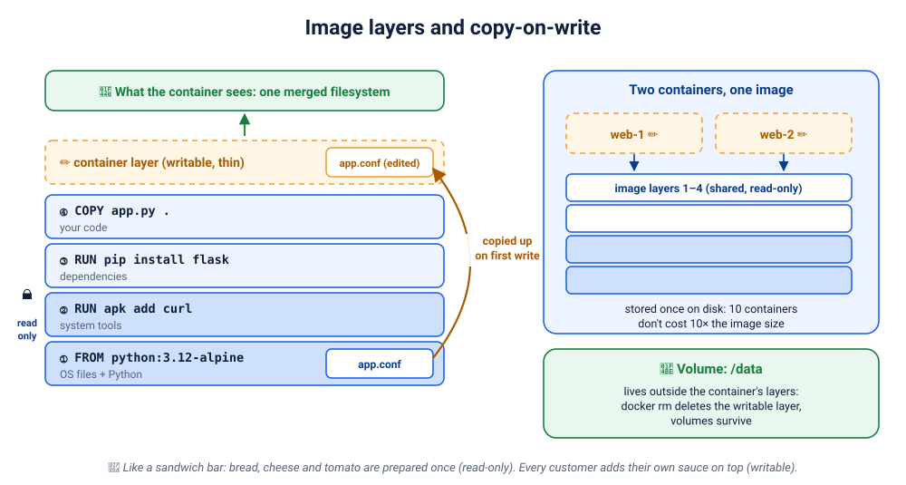

**Analogy.** A sandwich bar prepares the bread, cheese and tomato **once**, in advance. Every customer gets the same base and adds **their own sauce on top**. Nobody's sauce changes the shared ingredients.

**Technical.**
- An image is a stack of **read-only layers**. Each Dockerfile instruction that changes files (`FROM`, `RUN`, `COPY`) adds one.
- Layers are **shared**: 10 containers from the same image don't store the image 10 times.
- Each container gets one thin **writable layer** on top. A union filesystem (**overlayfs**) merges everything into the single `/` the container sees.
- **Copy-on-write:** when a container modifies a file that lives in a read-only layer, the file is first **copied up** into the writable layer and changed there. The image itself is never touched.
- When you **delete** the container, its writable layer is deleted too, along with anything written there. That's why databases use **volumes**, which live outside the layers (Lab D06).

🔬 **Prove it:**
```bash
docker image history nginx:1.27-alpine        # the layers, and the Dockerfile step that made each
docker exec web touch /tmp/hello              # add a file
docker exec web rm /etc/nginx/conf.d/default.conf   # "delete" a file from the image
docker diff web
```
```
C /etc/nginx/conf.d
D /etc/nginx/conf.d/default.conf
A /tmp/hello
…
```
`A` = added, `C` = changed, `D` = deleted, **all recorded only in this container's writable layer**. Start a new container from the same image and `default.conf` is back, untouched:
```bash
docker run --rm nginx:1.27-alpine ls /etc/nginx/conf.d/      # default.conf
docker rm -f web
```
> In `docker image history`, rows marked `<missing>` aren't errors. They're layers that came from the base image you pulled, which you didn't build locally.

### ⚡ Quick check
<details><summary>1. Which kernel feature makes the app think it's PID 1, and which one stops it from using all the RAM?</summary>

The **PID namespace** gives it its own process numbering. **cgroups** (the memory controller) cap its memory.
</details>
<details><summary>2. You delete a file inside a running container. Is it gone from the image?</summary>

No. Image layers are read-only. The deletion is recorded as a "whiteout" in the container's writable layer. New containers from the image still have the file.
</details>

---

## 8. Images vs containers

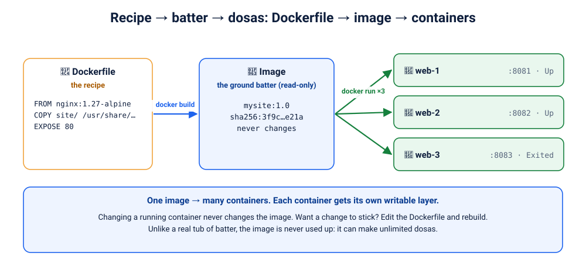

**Analogy: the cake.**
- 📄 **Dockerfile** = the **recipe**: a text file of instructions.
- 🎂 **Image** = the **baked cake**: the result of following the recipe; fixed, unchangeable.
- 🍰 **Container** = a **slice being served**: a running instance of the image. One cake, many slices.
- 🏪 **Registry** = the **bakery shelf** where cakes are stored and picked up.

⚠️ *Where the analogy stops:* a real cake gets used up. An image never does: one image can start **unlimited** containers, and running them doesn't change the image at all.

| | Image | Container |
|---|---|---|
| What | read-only template | running (or stopped) instance |
| Created by | `docker build` / `docker pull` | `docker run` / `docker create` |
| Changes? | **never** (immutable; a new build = a new image) | has its own writable layer |
| Identity | `name:tag` and a content **digest** | container ID and name |
| Lifetime | until you delete it | from `create` to `rm` |

🔬 **One image, three containers:**
```bash
docker run -d --name slice1 -p 8081:80 nginx:1.27-alpine
docker run -d --name slice2 -p 8082:80 nginx:1.27-alpine
docker run -d --name slice3 -p 8083:80 nginx:1.27-alpine
docker ps --format 'table {{.Names}}\t{{.Image}}\t{{.Ports}}'
docker exec slice1 sh -c 'echo "<h1>I am slice 1</h1>" > /usr/share/nginx/html/index.html'
curl -s localhost:8081 | head -1      # changed
curl -s localhost:8082 | head -4      # untouched: each slice has its own writable layer
docker rm -f slice1 slice2 slice3
```
> 🧠 **Changing a running container never changes the image.** Want a change to stick? Edit the **Dockerfile** and **rebuild**. That's what Lab D04 is about.

---

## 9. How images travel: registries

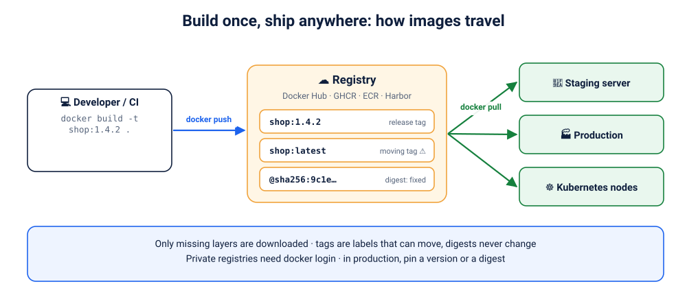

1. A developer, or better, a CI pipeline, **builds** an image: `docker build -t shop:1.4.2 .`
2. It's **pushed** to a registry: `docker push registry.example.com/shop:1.4.2`
3. Every environment **pulls** that **same** image: test, staging, production, Kubernetes nodes.

Key ideas:
- **Name anatomy:** `docker.io/library/nginx:1.27-alpine` = registry / namespace / repository : **tag**
- **Tags are movable labels** (`latest` can point to something new tomorrow). **Digests** (`@sha256:…`) are fingerprints of the exact content and **never change**.
- Only **missing layers** are transferred, so pushes and pulls are fast after the first one.
- Private registries need `docker login`.

> 🏭 **Build once, run everywhere:** the image tested in staging is byte-for-byte the image that runs in production. That's the cure for "it works on my machine".

---

## 10. Your first 12 commands, explained

Run them **in order**. They tell a story: check the kitchen → get an image → run it → look inside → clean up.

### 1. `docker version`
| | |
|---|---|
| **What** | prints the client **and** server (engine) versions |
| **Why** | the fastest check that Docker is installed *and* the daemon is reachable |
| **Inside** | CLI calls `GET /version` on the daemon's API |
| **Expect** | a `Client:` section and a `Server:` section (Engine, containerd, runc). Only `Client:` plus an error means the daemon is down |
| **Real world** | the first command in every CI job and every "Docker isn't working" ticket |

### 2. `docker info`
| | |
|---|---|
| **What** | detailed facts about the engine: containers, images, storage driver, cgroup version, CPUs, memory |
| **Why** | find out what you're working with and how much room you have |
| **Inside** | `GET /info` |
| **Expect** | `Containers: … Images: … Storage Driver: … Cgroup Version: 2 … CPUs: … Total Memory: …` |
| **Real world** | "why is Docker slow?" → check memory, disk and storage driver here |

### 3. `docker images`
| | |
|---|---|
| **What** | lists images in the local store (alias of `docker image ls`) |
| **Why** | see what's in the "pantry" before cooking |
| **Inside** | `GET /images/json` |
| **Expect** | `REPOSITORY  TAG  IMAGE ID  CREATED  SIZE`, possibly empty on a fresh install |
| **Real world** | spotting huge images and old versions that eat disk space |

### 4. `docker pull nginx:1.27-alpine`
| | |
|---|---|
| **What** | downloads an image from a registry without running it |
| **Why** | pre-load images before a demo or deploy; check that a tag exists |
| **Inside** | resolve the name → fetch the manifest for your CPU architecture → download missing layers → unpack |
| **Expect** | one line per layer (`Pull complete`), then `Digest: sha256:…` and `Status: Downloaded newer image…` |
| **Real world** | Kubernetes nodes do exactly this before starting your Pods |

> Typing just `nginx` means `nginx:latest`. Fine for experiments, never for production (Lab D10 explains why).

### 5. `docker run -d --name web -p 8080:80 nginx:1.27-alpine`
| | |
|---|---|
| **What** | creates **and** starts a container: `-d` in the background, `--name` a friendly name, `-p` publishes port 80 as 8080 on your laptop |
| **Why** | the command you'll use most |
| **Inside** | the whole chapter 6 flow: create → (pull if needed) → containerd → runc → namespaces + cgroups → start |
| **Expect** | a long container ID. Open http://localhost:8080 for the nginx welcome page |
| **Real world** | running databases, caches and web servers locally in seconds |

### 6. `docker ps`
| | |
|---|---|
| **What** | lists **running** containers |
| **Why** | "is my app up? which port? for how long?" |
| **Inside** | `GET /containers/json` |
| **Expect** | `CONTAINER ID  IMAGE  COMMAND  CREATED  STATUS  PORTS  NAMES`, with `web` showing `Up X seconds` and `0.0.0.0:8080->80/tcp` |
| **Real world** | the first command when something "isn't responding" |

### 7. `docker ps -a`
| | |
|---|---|
| **What** | lists **all** containers, including stopped ones |
| **Why** | a container that crashed disappears from `docker ps` but not from `-a` |
| **Inside** | same API call with `all=true` |
| **Expect** | stopped containers show `Exited (code) … ago` |
| **Real world** | "my container won't stay up": the exit code here is your first clue |

### 8. `docker inspect web`
| | |
|---|---|
| **What** | the complete JSON description of a container: config, state, network, mounts |
| **Why** | find out what's *actually* configured, not what someone thinks is configured |
| **Inside** | `GET /containers/web/json` |
| **Expect** | a long JSON document. Try `docker inspect web --format '{{.State.Status}} {{range .NetworkSettings.Networks}}{{.IPAddress}}{{end}}'` |
| **Real world** | checking env vars, exit codes, `OOMKilled`, IP addresses and mounts during incidents |

### 9. `docker logs web`
| | |
|---|---|
| **What** | shows what the container's main process wrote to **stdout/stderr** |
| **Why** | the app's own explanation of what happened |
| **Inside** | Docker captures the process's output streams and stores them via a logging driver |
| **Expect** | nginx start-up lines, plus one access-log line per request after you visit the page. Add `-f` to follow live |
| **Real world** | step one of almost every debugging session. Log platforms collect exactly this stream |

### 10. `docker exec -it web sh`
| | |
|---|---|
| **What** | starts an **extra** process (a shell) inside the running container's namespaces |
| **Why** | look around from the inside: files, processes, network |
| **Inside** | containerd starts a new process that joins the **same namespaces and cgroup** as the container |
| **Expect** | a `/ #` prompt. Try `ps`, `hostname`, `cat /etc/os-release`, then `exit` (the container keeps running) |
| **Real world** | investigating. But **never fix things this way in production**: the change vanishes when the container is replaced |

### 11. `docker stop web`
| | |
|---|---|
| **What** | asks the container to shut down gracefully |
| **Why** | let the app finish requests and close connections cleanly |
| **Inside** | sends the image's stop signal (SIGTERM by default; the nginx image uses SIGQUIT) to PID 1, waits (10 s by default), then SIGKILL |
| **Expect** | prints `web`. `docker ps -a` shows `Exited (0)` |
| **Real world** | every deployment stops old containers this way; apps must handle the signal (Lab D05) |

### 12. `docker rm web`
| | |
|---|---|
| **What** | deletes a stopped container (`-f` stops it first) |
| **Why** | stopped containers keep their writable layer and take disk space |
| **Inside** | deletes the container's writable layer and its metadata. **The image stays** |
| **Expect** | prints `web`. It's gone from `docker ps -a`, but `docker images` still lists nginx |
| **Real world** | containers are disposable: you don't repair them, you replace them |

---

## 11. Myths, busted

| Myth | Reality |
|---|---|
| "Docker invented containers." | It **popularised** them. chroot, Jails, Zones, namespaces, cgroups and LXC came first. |
| "A container is a lightweight VM." | It's an **isolated process** on a shared kernel. There's no guest OS and no virtual hardware. |
| "Containers are 100% secure by default." | Isolation is good but not perfect. Run as non-root, drop capabilities, limit resources, scan images (D05, D11). |
| "Data inside a container is safe." | It vanishes with `docker rm`. Use **volumes** for anything you care about (D06). |
| "Docker = containers." | Docker is one toolset. Podman, containerd/nerdctl and Kubernetes all run the **same OCI images**. |
| "Kubernetes dropped Docker, so Docker is dead." | Kubernetes dropped an *adapter* (dockershim). Images built with Docker run everywhere, and developers still use Docker daily (K00). |
| "On my Mac, containers run on macOS." | They run in a small **Linux VM** that Docker Desktop manages. |

---

## 12. Recap, the final challenge, and the quiz

### 🧠 The whole module on one card
```
PROBLEM      "Works on my machine": code is the same, environments are not
IDEA         ship the app WITH everything it needs  →  an IMAGE
CONTAINER    an isolated process, from an image, on a SHARED kernel
ISOLATION    namespaces = what it can SEE · cgroups = what it can USE
FILES        read-only image layers + a thin writable layer (copy-on-write)
VM vs CTR    houses (own OS each) vs apartments (shared foundation = kernel)
DOCKER       CLI → REST API → dockerd → containerd → shim/runc → kernel
TRAVEL       build → push → registry → pull → run (same image everywhere)
```

### 🏆 Final challenge: explain Docker to a 10-year-old in 5 minutes
Close this page. Using only what you remember, explain to a friend or a family member (or record yourself):
1. What problem did people have before Docker?
2. What's inside a container image?
3. How is a container different from a virtual machine? (Use the houses and apartments.)
4. What happens when you type `docker run`?

<details><summary>💬 One possible 5-minute answer (peek only after you've tried!)</summary>

> "You know how a game you install on your computer sometimes doesn't work because something else is missing? Programmers had the same problem: a program worked on one computer and broke on another, because the computers had different stuff installed.
>
> Docker fixes that by packing the program **together with everything it needs**, like shipping a toy with its batteries already inside and every piece in its own slot. That package is called an **image**.
>
> When you **run** the image, you get a **container**: the program, running in its own private room. It has its own stuff and can't mess with the other rooms. But all the rooms share one building, the computer's core, called the **kernel**. That's why containers are small and start super fast, unlike virtual machines, which are like building a whole separate house for every program.
>
> When you type `docker run`, Docker checks whether it already has the package. If not, it downloads it from an online library, like an app store. Then it asks the computer to make a private room and start the program inside it. One package can make as many rooms as you want, and they all behave exactly the same, on any computer."
</details>

### 📝 Test yourself
**[Take the D00 quiz →](quiz.md)** 50 questions: 20 conceptual, 10 scenarios, 10 architecture, 5 VM vs container, 5 troubleshooting. Answers included.

### 🧹 Cleanup
```bash
docker rm -f web demo demo2 slice1 slice2 slice3 2>/dev/null
```

➡️ **Next:** [D01: First Steps & the Image Arcade](../01-first-steps/README.md). Now that you know what's happening under the hood, every command you type from here on will make sense.
