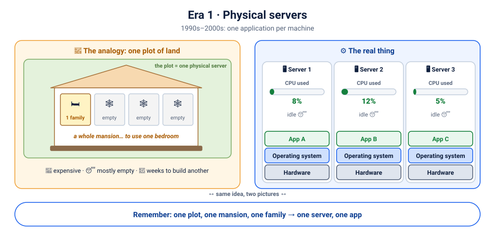
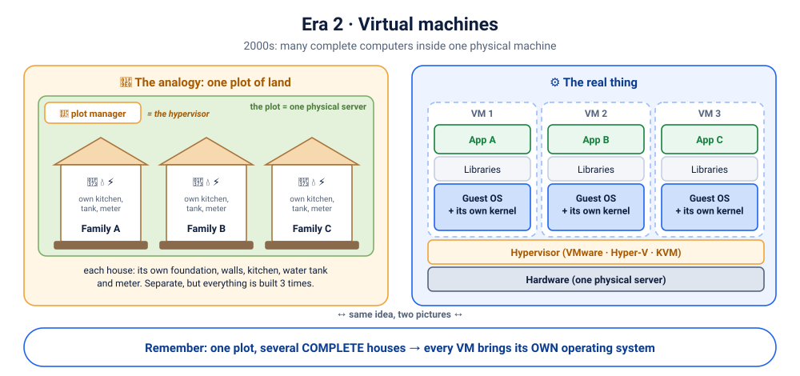
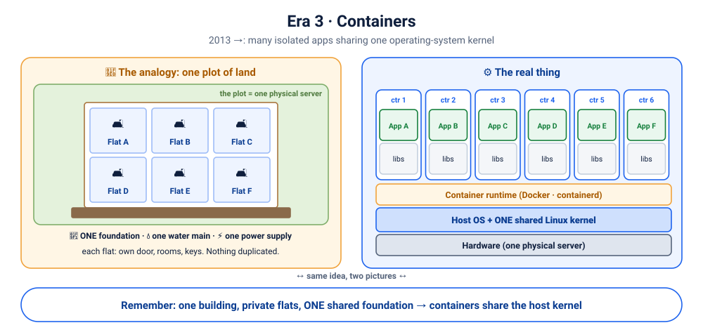
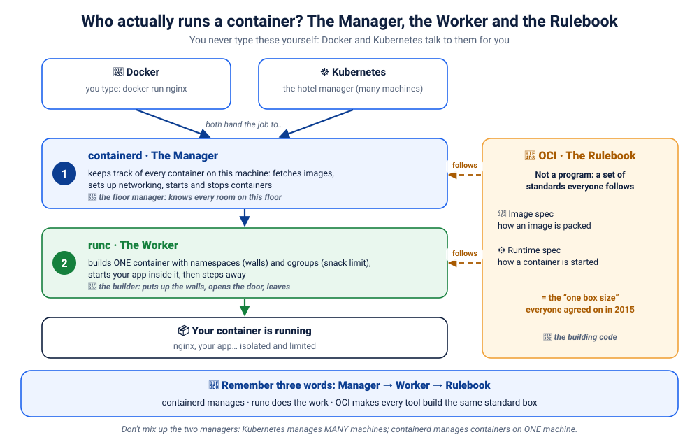

# Lab D00: Docker Foundations: Why Containers Exist and How Docker Really Works

> ⏱ 2.5–3 hours · 🟢 Absolute beginner: no IT background needed · 🧪 hands-on parts need Docker ([setup](../../00-setup/README.md))

By the end of this module you will be able to explain, **in your own words and without notes**:

- why Docker was invented, and what was painful before it
- what "containerization" actually means, and why the industry adopted it
- how a container differs from a virtual machine
- what really happens, component by component, when you type `docker run`
- what images, containers, layers, namespaces and cgroups are

Every concept follows the same rhythm:

> **Explain** in plain words → **Illustrate** with a picture → **Relate** it to everyday life → **Map** it to the real technology → **Prove it** with a command → **Quick check** ⚡

<details><summary>📑 Contents</summary>

1. [The problem before Docker](#1-the-problem-before-docker)
2. [Containerization in one sentence](#2-containerization-in-one-sentence)
3. [How we got here: the evolution of deployment](#3-how-we-got-here-the-evolution-of-deployment)
4. [Virtual machines vs containers](#4-virtual-machines-vs-containers)
5. [Docker architecture, explained as a restaurant](#5-docker-architecture-explained-as-a-restaurant)
6. [What happens when you type `docker run nginx`](#6-what-happens-when-you-type-docker-run-nginx)
7. [Inside a container: namespaces, cgroups and layers](#7-inside-a-container-namespaces-cgroups-and-layers)
8. [Images vs containers](#8-images-vs-containers)
9. [How images travel: registries](#9-how-images-travel-registries)
10. [Your first 12 commands, explained](#10-your-first-12-commands-explained)
11. [Myths, busted](#11-myths-busted)
12. [Recap, the final challenge, and the quiz](#12-recap-the-final-challenge-and-the-quiz)
</details>

---

## 1. The problem before Docker

### Story 1: the phone that arrived broken 📱

You order a brand-new phone online. Two different sellers ship the **same phone**.


- **Seller A** drops it, loose, into a big cardboard box. No bubble wrap, no tray. It slides around for three days. It arrives scratched, the charger is missing, and it might not even switch on.
- **Seller B** ships it in its original fitted packaging: a tray for the phone, slots for the charger and cable, everything held in place. It arrives **exactly as it left the factory**.

So, what made the difference? Not the phone, and not the delivery driver. **The packaging made the difference.** Good packaging makes delivery *predictable*.

Now swap the phone for software:

| Everyday world | Software world |
|---|---|
| 📱 The phone | Your **application** (code) |
| 🔌 Charger, cable, SIM tool | Its **runtime and libraries**: Python 3.11, Flask, system libraries, config files |
| 📦 The sealed, fitted package | A **container image**: the app *plus everything it needs to run*, sealed together |
| 📬 The phone unboxed and switched on | A **container**: the image, actually running |
| 🚚 The packing and shipping system | **Docker**: the tools that build, ship and run those packages |

> 🧠 **The one sentence to remember:**
> **Don't just ship the application. Ship the application with everything it needs to run.**

⚠️ *Where the analogy stops:* an image is not a physical box. It is a set of **read-only file layers plus metadata** (which command to run, which port, which environment variables). "Shipping" it means uploading and downloading files. Keep the intuition, and drop the cardboard.

### Story 2: "It works on my machine!" 🤷

A conversation that has happened in every software company on Earth:

> 👩‍💻 **Developer:** It works perfectly on my laptop!
> 🧪 **Tester:** It crashes on my machine.
> 👩‍💻 **Developer:** Impossible. I tested it yesterday!
> 🛠️ **Operations engineer:** It doesn't even *start* in production.
> 👩‍💻 **Developer:** Then maybe your server just doesn't like my application. 🙃


Here's what was really going on. The app needs **Python 3.11, Flask 3.0, OpenSSL 3, and an environment variable `DB_URL`**:

| | Python | Flask | libssl | `DB_URL` | Result |
|---|---|---|---|---|---|
| 💻 Developer laptop | 3.11 | 3.0 | 3 | set | ✅ works |
| 🧪 Tester's machine | 3.10 | 2.2 | 3 | set | ⚠️ crashes on login (Flask API changed) |
| 🏭 Production server | 3.9 | 2.0 | 1.1 | missing | ❌ won't start |

Nobody was lying. **The code was the same; the environments were not.** Before containers, teams wrote 40-page "installation guides", hoped every server was set up identically, and spent days on "environment drift".

**What Docker changes:** the app ships *together with* Python 3.11, Flask 3.0 and its libraries, as one image. The laptop, the tester and the production server all run **the same image**. Only genuine settings such as `DB_URL` differ, and they're passed in from outside (you'll do exactly this in Lab D04).

### ⚡ Quick check
<details><summary>1. In the phone story, which part is the "image" and which is the "container"?</summary>

The sealed, fitted package is the **image** (everything packed, nothing running). The phone unboxed and switched on is the **container** (the package in use).
</details>
<details><summary>2. Does Docker remove the need for configuration like <code>DB_URL</code>?</summary>

No. Docker packages the app and its *dependencies*. Settings that differ per environment (database addresses, passwords) are still supplied from outside, through environment variables, config files or secrets, so that the same image can run everywhere.
</details>

---

## 2. Containerization in one sentence

> **Containerization** means packaging an application together with everything it needs (its runtime, libraries and files) into a standard unit that runs **isolated** from other software but **shares the host computer's operating-system kernel**.

Three words carry all the meaning:

| Word | Meaning | Why it matters |
|---|---|---|
| **Packaged** | app + dependencies in one image | the same thing runs everywhere |
| **Isolated** | each container has its own files, processes and network view | apps can't break each other |
| **Shared kernel** | no full operating system per app | small, fast to start, efficient |

You'll understand each word deeply by the end of chapter 7.

---

## 3. How we got here: the evolution of deployment

### First, why are they called "containers"? 🚢

Before 1956, ships were loaded **by hand**: sacks of rice, barrels of oil, crates of machinery, each a different shape and each handled differently. Loading one ship could take a week, and goods were often damaged or stolen.

Then trucking entrepreneur **Malcom McLean** shipped goods in **standard steel boxes**. Every port, crane, truck and train could handle *any* box the same way, without caring what was inside. Global trade exploded.

Software containers borrowed the idea and the name: **a standard box for software**, so that every laptop, server and cloud can run it the same way without caring what's inside.


### 🗺️ One plot of land, three ways to use it
To remember the first three eras **forever**, picture **one plot of land** that never changes. The plot is **one physical server**: its CPU, memory and disk. Each era is simply a smarter way to use the same land.

| Era | 🧠 On the plot of land | ⚙️ On the server | Families (apps) per plot |
|---|---|---|---|
| 1 · Physical | 🏚️ **one mansion**, one family, one bedroom used | one OS, one app | 1 |
| 2 · Virtual machines | 🏡🏡🏡 **several complete houses**, each with its own foundation, kitchen, water tank and meter | one hypervisor, several VMs, each with its **own full OS** | a handful |
| 3 · Containers | 🏢 **one apartment building**: private flats on **one shared foundation** | one OS kernel, many isolated containers | many |

The question that separates Era 2 from Era 3: **is the foundation duplicated or shared?** Houses each have their own (VMs each have their own OS kernel). Flats share one (containers share the host kernel).

### Era 1: physical servers (1990s–2000s) 🏚️


**The analogy.** A family buys an entire plot, builds a mansion, and lives in **one bedroom**. The other rooms gather cobwebs. Want a second family nearby? Buy a second plot and build another mansion, which takes months.

**The real thing.** **One application per physical server.** A web app, a database and a reporting tool meant three servers.

- 💸 Expensive: each server costs money, power, space and cooling.
- 😴 Wasteful: most servers sat at 5–15% CPU usage. (That's a common industry rule of thumb, not a law.)
- 🐢 Slow: getting a new server could take weeks (order, deliver, rack, install).
- 💥 Conflicts: put two apps on one server and they fight over library versions and ports, like two families forced to share one kitchen with no rules.

> 🧠 **Remember:** one plot, one mansion, one family → **one server, one app**.

### Era 2: virtual machines (2000s) 🧱


**The analogy.** A clever owner divides the **same plot** and builds **several small, complete houses** on it. A **plot manager** decides how much land each house gets. Every house is fully independent: **its own foundation, walls, kitchen, water tank and electricity meter**. If one family's pipes burst, the neighbours are fine. But notice: every house **builds everything again**: three foundations, three kitchens, three water tanks.

**The real thing.** A **hypervisor** (VMware, Hyper-V, KVM, Xen), the plot manager, splits one physical server into several **virtual machines**. Each VM pretends to be a complete computer, with **its own operating system and its own kernel**: its own foundation.

- ✅ Much better land use: 10–20 VMs on one server instead of 10–20 servers
- ✅ Strong isolation: a crash in one VM doesn't affect another
- ❌ Every VM carries a **full guest OS**: often gigabytes of disk, its own memory, its own patching and its own boot time. Every house needs its own foundation
- ❌ "Works on my machine" still happens *inside* the VMs

> 🧠 **Remember:** one plot, several **complete** houses → **every VM brings its own operating system**.

### Era 3: containers (OS-level isolation) 📦


**The analogy.** Instead of separate houses, the owner builds **one apartment building**. Every family gets a **private flat**: its own door, rooms, furniture and keys, and nobody walks into anyone else's flat. But the building has **one foundation, one water main and one power supply**, built once and shared by everyone. Far more families fit on the same land, and a new flat is ready almost instantly, because the foundation already exists.

**The real thing.** Containers don't virtualise **hardware**; they isolate **processes**, using features built into the Linux kernel (chapter 7). All containers share the host's **one kernel** (the foundation), but each gets its own private view of files, processes and network (its own flat).

- ✅ No OS to boot, so containers typically start in **about a second**
- ✅ Images are often **megabytes**, not gigabytes: nothing duplicated
- ✅ Dozens or hundreds of containers per machine

> 🧠 **Remember:** one building, private flats, **one shared foundation** → **containers share the host kernel**.

### Era 4: Docker changes the game (2013) 🐳
**Important history:** Docker did **not** invent containers. The building blocks are decades old:

| Year | Technology | What it gave us |
|---|---|---|
| 1979 | `chroot` (Unix V7) | give a process its own "root" folder |
| 2000 | FreeBSD **Jails** | isolated mini-systems on one OS |
| 2004 | Solaris **Zones** | isolated OS environments |
| 2002–2013 | Linux **namespaces** | isolate what a process can *see* |
| 2008 | Linux **cgroups** (from Google engineers) | limit what a process can *use* |
| 2008 | **LXC** (Linux Containers) | combined both into usable containers |

So what *did* Docker do? In **March 2013**, Solomon Hykes of the platform company **dotCloud** demoed Docker at PyCon and open-sourced it. dotCloud soon renamed itself **Docker, Inc.** Docker made containers **easy and portable** for ordinary developers:

- 📄 **Dockerfile**: a simple text recipe for building an image
- 🖼️ **Images**: layered, versioned, shareable packages
- ☁️ **Docker Hub** (2014): an online library of ready-made images
- ⌨️ **One CLI**: `docker build`, `docker push`, `docker run`, the same on every machine

Containers went from "a Linux kernel expert's tool" to "something every developer uses daily".

### Era 5: the modern container ecosystem (2015 → today) 🌐
As containers took over, the industry standardised the pieces so nobody depended on one company:

- **OCI** (Open Container Initiative, 2015): open standards for the **image format** and the **runtime**. An image built by Docker runs on any OCI-compliant runtime.
- **runc**: the small, low-level tool that actually creates containers. Docker donated it to the OCI.
- **containerd**: the runtime that manages container lifecycles. Docker split it out and donated it to the **CNCF** in 2017; Kubernetes and Docker both use it today.
- **Kubernetes** (open-sourced 2014, v1.0 in 2015): runs containers across **many** machines. That's Track 2 of this course.
- **Cloud native**: apps designed as many small, independently deployable containerised services.

### 🧒 The whole story in 2 minutes
> **Start with a question:** *"Who here shares a room with a brother or sister? What happens when they touch your stuff?"* 😤

Computers have the same problem. One computer runs many programs, and programs "fight": one gobbles all the memory, another messes up someone else's files. Since 1979, people have been finding better ways to give **each program its own room**.

| Year | 🧒 The picture | ⚙️ The real name | What it added |
|---|---|---|---|
| 1979 | 🪟 **A curtain** in a shared room. You can't see the other side, but you can still hear everything and eat all the snacks. | `chroot` | a private view of **files** only |
| 2000 · 2004 | 🧱 **Real walls.** Proper private rooms, but only in a few buildings (FreeBSD, Solaris), and hard to build. | Jails · Zones | real isolation, rarely used |
| 2008 | 🍪 **A snack limit.** *"This room gets only 2 cookies (memory) and 1 hour of TV (CPU)."* | cgroups + LXC | **limits**, so one greedy program can't take everything. Powerful, but expert-only: building a house from raw bricks. |
| 2013 | 📦 **Ready-made rooms in a box.** One command gives you a furnished room for any program, and you can hand a copy to a friend that works **exactly the same** on their computer. | **Docker** | made containers **easy and shareable** |
| 2014 | 📚 **A library of rooms** and 🏨 **a hotel manager** who looks after thousands of rooms in many buildings and moves guests when a room breaks. | Docker Hub · Kubernetes | sharing + running at huge scale |
| 2015 · 2017 | 🤝 **Everyone agrees on one box size**, like shipping containers that fit every ship and truck. Docker also gives its engine room to the community. | OCI · runc · containerd | rooms from any tool work everywhere |
| 2022 | 🔧 **The hotel manager talks to the floor manager directly**, skipping the middle-man. Rooms made with Docker still work perfectly. | K8s drops dockershim | simpler, same standard box |

> 🎯 **The big message:** Docker **didn't invent** the walls or the snack limit; they already existed. Docker's magic was making them **so easy that a student can do it in one command.**

#### 🧠 Never forget it: the 7-step chain
Say it out loud once, then try it from memory:

**🪟 Curtain → 🧱 Walls → 🍪 Snack limit → 📦 Ready-made room → 📚 Library + 🏨 Hotel manager → 🤝 Standard box → 🔧 Direct line**

<details><summary>🎤 Teach it back (the best way to never forget)</summary>

Explain the chain to the person next to you in 60 seconds, **without** looking. Then swap. If you can teach it, you own it. Bonus: tell someone at home tonight. If a 10-year-old gets it, you've mastered it.
</details>

### 🧩 One step deeper: who actually runs your container?
> 😌 **Relax: nothing to memorise or type here.** You'll never run these programs yourself in this course. Docker and Kubernetes use them for you. You only need **three words**.

You've heard the names *containerd*, *runc* and *OCI* in the story above. Here's how they fit together:



| Name | Its nickname | Its one job | 🧒 In the "own room" story |
|---|---|---|---|
| **containerd** | 🧑‍💼 **The Manager** | Looks after **all** the containers on one machine: fetches images, sets up the network, starts and stops containers | the **floor manager** who knows every room on the floor |
| **runc** | 👷 **The Worker** | Builds **one** container using namespaces (the *walls*) and cgroups (the *snack limit*), starts your app, then steps away | the **builder** who puts up the walls, opens the door and leaves |
| **OCI** | 📘 **The Rulebook** | **Not a program.** The standards for how images are packed and how containers are started | the **building code** every builder follows: the "one box size" |

Why should you care? Just **two** reasons:
1. **It's why "build once, run anywhere" works.** Docker and Kubernetes both hand containers to **containerd**, and everything follows the **OCI** rulebook. So an image you build with Docker on your laptop runs unchanged on Kubernetes in the cloud.
2. **You'll see these names in error messages** (`failed to create containerd task`, `runc create failed`). Now you'll know: *"the Manager or the Worker hit a problem"*, and usually your app or its settings are the cause.

> ⚠️ **Don't mix up the two managers.** Kubernetes is the **hotel manager** for **many** machines. containerd is the **floor manager** on **one** machine. Kubernetes tells containerd what to do; containerd asks runc to build each room.

<details><summary>🔬 30-second proof: meet the Manager and the Worker on your own machine</summary>

```bash
docker version --format '{{range .Server.Components}}{{.Name}} {{.Version}}{{"\n"}}{{end}}'
```
```
Engine 29.7.2
containerd v2.3.3
runc 1.4.3
docker-init 0.19.0
```
There they are: when you install Docker, you also get **containerd** (the Manager) and **runc** (the Worker). Your versions may differ. You'll see exactly how a `docker run` flows through them in [chapter 5](#5-docker-architecture-explained-as-a-restaurant) and [chapter 6](#6-what-happens-when-you-type-docker-run-nginx).
</details>

### ⚡ Quick check
<details><summary>1. Did Docker invent containers?</summary>

No. chroot (1979), FreeBSD Jails (2000), Solaris Zones (2004), Linux namespaces, cgroups and LXC (2008) all came first. Docker **popularised** containers by making them simple and portable: Dockerfiles, layered images, Docker Hub and one consistent CLI.
</details>
<details><summary>2. What problem did VMs solve, and which one did they leave?</summary>

VMs solved *hardware waste* by putting many isolated machines on one server. They didn't solve *packaging*: each VM still needs a full OS and still suffers from "works on my machine" inside it. And each one carries the overhead of a whole guest OS.
</details>
<details><summary>3. In the "own room" story, which one is the snack limit, and what does it stop?</summary>

**cgroups** (2008). It caps how much memory and CPU a container can use, so one greedy program can't starve the others. You'll use it yourself in chapter 7.2.
</details>
<details><summary>4. Who is the "hotel manager", and who is the "library of rooms"?</summary>

The hotel manager is **Kubernetes**: it runs and looks after thousands of containers across many machines. The library is **Docker Hub** (a registry): where ready-made images are shared.
</details>
<details><summary>5. Kubernetes dropped dockershim in 2022. Do images built with Docker still run on Kubernetes?</summary>

Yes. Thanks to the **OCI standard** (the "one box size"), any OCI image runs on any OCI runtime. Kubernetes simply talks to **containerd** directly instead of going through Docker.
</details>
<details><summary>6. Manager, Worker, Rulebook: match them to containerd, runc and OCI. Which one is not a program?</summary>

containerd = **Manager** (looks after all containers on a machine), runc = **Worker** (builds and starts one container), OCI = **Rulebook** (the standards). OCI is **not a program**: it's a set of specifications that containerd and runc follow.
</details>

---

## 4. Virtual machines vs containers

This is the most important comparison in the whole course. Take your time here.


### The house vs apartment analogy
Remember Era 2's **houses** and Era 3's **apartment building** on the same plot? Here they are side by side, because this single picture is the whole difference.


**Virtual machines are separate houses.** Each house has its own foundation, plumbing, electrical wiring and water tank. If your neighbour's pipes burst, your house is fine. But building every house from scratch is slow and uses a lot of land.

Each **VM** similarly has its own virtual hardware, **its own complete guest operating system and kernel**, its own libraries and the app. The hypervisor keeps them apart.

**Containers are apartments in one building.** Each family has a private flat: its own door, rooms, furniture and doorbell name. But all flats share the building's **foundation, water mains and power supply**.

Each **container** similarly has its own isolated processes, filesystem, network and hostname, but **all containers share the host's Linux kernel**.

| Feature | Virtual machine | Container |
|---|---|---|
| Operating system | full guest OS with its own kernel | shares the host's kernel |
| Typical size | gigabytes | megabytes to hundreds of MB |
| Typical startup | tens of seconds to minutes (an OS boots) | well under a second to a few seconds (a process starts) |
| Isolation boundary | hardware virtualisation (hypervisor) | OS-level (namespaces + cgroups) |
| Resource overhead | higher: every VM runs a whole OS | lower: just your app's processes |
| Portability unit | VM disk images (VMDK, VHD, QCOW2…) | OCI container images |
| Typical use | different OSes (e.g. Windows on a Linux host), strong multi-tenant isolation, legacy apps | microservices, packaging apps, CI, fast scaling |

> These are **general characteristics, not guarantees**. A tiny VM can boot fast, and a badly built container image can be huge.

### 🔬 Prove the "shared kernel" with your own eyes
Run two containers from **completely different Linux distributions** and ask each one which kernel it's using:
```bash
docker run --rm alpine grep PRETTY /etc/os-release
docker run --rm ubuntu:24.04 grep PRETTY /etc/os-release
docker run --rm alpine uname -r
docker run --rm ubuntu:24.04 uname -r
```
Example output (yours will differ):
```
PRETTY_NAME="Alpine Linux v3.24"
PRETTY_NAME="Ubuntu 24.04.5 LTS"
7.0.12-linuxkit
7.0.12-linuxkit
```
🤯 **Different distributions, exactly the same kernel.** Alpine and Ubuntu bring their own *files* (shell, libraries, package manager), but they run on the **one kernel** of the host.

> 🍎 **On macOS and Windows**, Docker Desktop quietly runs a small **Linux VM** (that's the `-linuxkit` kernel), and all your containers share *its* kernel. So containers and VMs are **teammates, not rivals**. In the cloud, containers usually run inside VMs too.

### When would you still choose a VM?
- you need a **different kernel or OS**: Windows software, an old Linux kernel, a kernel module
- you run **untrusted code from different customers** and need the strongest isolation (some platforms use lightweight "micro-VMs" such as Firecracker or Kata Containers to get both)
- legacy software that expects a whole machine

⚠️ *Where the apartment analogy breaks:* a kernel bug is a **crack in the shared foundation**: it can affect every flat. That's why containers are hardened (non-root users, dropped capabilities, seccomp; see Lab D11) and why VMs still matter.

### ⚡ Quick check
<details><summary>1. A container shows "Ubuntu 24.04", yet <code>uname -r</code> prints the host's kernel. How?</summary>

The container brings Ubuntu's **files** (its userland: shell, libraries, apt), but there is no Ubuntu kernel inside. Every container uses the host's kernel. That is the core difference from a VM.
</details>
<details><summary>2. Can a Linux container run a Windows <code>.exe</code> natively?</summary>

No. Containers share the host kernel, and a Linux kernel can't run Windows binaries natively. You'd need a Windows host (Windows containers) or a VM.
</details>

---

## 5. Docker architecture, explained as a restaurant

Forget the jargon for a moment. It's Sunday morning, and the breakfast rush at **The Rameshwaram Cafe** is in full swing. You order **one masala dosa**. Follow that single order:


1. 🧑 **You** order at the counter: "one nginx dosa, please!"
2. 🧾 **The billing counter** takes your order, gives you a token, and passes it to the kitchen. The counter never cooks.
3. 👩‍🍳 **The head chef** checks the kitchen **fridge**: is today's batter already here?
4. 🏬 If not, a tub is fetched from the **central cold store**. The cold store doesn't grind anything; it only **stores** batter that was already ground, each tub labelled with a name and date, and hands it to any kitchen that asks.
5. 🔥 **The cooks** pour the batter on the tawa and make *your* dosa, with your ghee and podi on top.
6. 🥞 **Served!** Your token is called, and your order is now real, on the plate.

*(The kitchen details are invented for the analogy.)* Now replace every breakfast word with its Docker word:

| 🍽️ At the cafe | 🐳 Docker | What it really is |
|---|---|---|
| 🧑 you, ordering | **you** | typing `docker run nginx` |
| 🧾 billing counter | **Docker CLI** (`docker`) | a client that turns your command into an API request |
| 👩‍🍳 head chef | **Docker daemon** (`dockerd`) | the background service that runs the show |
| 🧊 kitchen fridge | **local image store** | images already downloaded to this machine |
| 🏬 central cold store | **registry** (Docker Hub, GHCR…) | a server that **stores and hands out** images; it never builds them |
| 🔥 cooks at the tawa | **containerd + runc** | the runtimes that actually create the container |
| 🥣 the batter | **image** | the packaged app: read-only, never changes once ground |
| 🥞 a dosa on your plate | **container** | the image, running |
| 🧈 the ghee and podi on *your* dosa | the container's **writable layer** | changes that belong to that one container only (chapter 7) |
| 📄 recipe card | **Dockerfile** | how the image is built (`docker build`), before it's pushed to the cold store |

> 🧠 **Remember:** the registry is a **cold store, not a kitchen**. `docker build` grinds the batter, `docker push` delivers it to the cold store, and `docker pull` fetches it.

### The components at a glance
| # | Component | In the restaurant | Its one job |
|---|---|---|---|
| 1 | **Docker CLI** | billing counter | turns your command into an API call. It never runs containers itself |
| 2 | **dockerd** (Docker daemon) | head chef | receives requests; builds, pulls and pushes images; manages networks and volumes; asks the runtime to start containers |
| 3 | **Docker Engine** | the whole kitchen | the server side as a package: dockerd + its API + containerd + runc |
| 4 | **REST API** | the order token | how the CLI talks to dockerd, usually over the socket `/var/run/docker.sock` |
| 5 | **containerd** | kitchen supervisor (🧑‍💼 *the Manager* from §3) | manages each container's lifecycle (start, stop, snapshots). Kubernetes uses it too |
| 6 | **runc** | cook at the tawa (👷 *the Worker* from §3) | asks the Linux kernel for namespaces and cgroups, starts the process, then exits |
| 7 | **Image** | the batter | read-only package: file layers + settings (chapter 8) |
| 8 | **Container** | a dosa on a plate | a running, isolated process made from an image |
| 9 | **Registry** | central cold store | stores and distributes images: Docker Hub, GHCR, ECR, Harbor… |
| 10 | **Docker Hub** | the biggest public cold store | Docker's own registry. `nginx` means `docker.io/library/nginx:latest` |
| 11 | **Networks** | the kitchen intercom | let containers find each other by name (Lab D07) |
| 12 | **Volumes** | a labelled box in the cold room | data that survives when the container is removed (Lab D06) |

> 🔐 Anyone who can talk to `docker.sock` effectively has **root on the host**. Never expose it carelessly.

### 🔬 See the architecture on your own machine
```bash
docker version            # TWO sections: Client (the counter) and Server (the kitchen)
docker version --format '{{range .Server.Components}}{{.Name}}={{.Version}}  {{end}}'
docker info --format 'storage={{.Driver}}  runtime={{.DefaultRuntime}}  cgroups=v{{.CgroupVersion}}'
docker context ls         # which engine is your CLI talking to?
```
Example:
```
Engine=29.7.2  containerd=v2.3.3  runc=1.4.3  docker-init=0.19.0
storage=overlayfs  runtime=runc  cgroups=v2
```
There they are: **Engine (dockerd), containerd and runc**, three separate components with three separate version numbers.

### ⚡ Quick check
<details><summary>1. You type <code>docker ps</code> and get "Cannot connect to the Docker daemon". Which component is missing?</summary>

The **daemon** (`dockerd`) isn't running or isn't reachable. The client (CLI) works fine: it printed the error. Start Docker Desktop, or run `sudo systemctl start docker` on Linux.
</details>
<details><summary>2. Are Docker Engine, containerd and runc the same thing?</summary>

No. `dockerd` (Docker Engine's daemon) handles the API, images, networks, volumes and builds. **containerd** manages container lifecycles. **runc** creates the actual container process via the kernel, then exits. They're layered: dockerd → containerd → runc → kernel.
</details>

---

## 6. What happens when you type `docker run nginx`

One short command sets off an impressive chain reaction:


| Step | Who | What happens |
|---|---|---|
| ① | **CLI** | parses `docker run nginx`, expands `nginx` to `docker.io/library/nginx:latest`, sends `POST /containers/create` to the daemon over `docker.sock` |
| ② | **dockerd** | checks the **local image store**: is `nginx:latest` already here? |
| ③ | **dockerd → registry** | if not: downloads the image **manifest** (the list of layers for your CPU type: amd64 or arm64) |
| ④ | **registry → dockerd** | sends each missing **layer** (compressed); layers you already have are skipped |
| ⑤ | **dockerd / containerd** | unpacks the layers into a **snapshot** and adds a thin writable layer on top; prepares the container's config (command, env, ports, network, limits) |
| ⑥ | **dockerd → containerd** | "create this container and start its task" (via gRPC) |
| ⑦ | **containerd → shim → runc** | containerd starts a small **shim** process, which calls **runc** |
| ⑧ | **runc → Linux kernel** | creates **namespaces** (PID, network, mount, UTS, IPC…), applies **cgroup** limits, mounts the filesystem, then **executes** nginx's start command |
| ⑨ | **kernel** | nginx is now running as **PID 1** inside its own namespaces; runc exits, and the shim stays as nginx's parent |
| ⑩ | **dockerd → CLI** | returns the container ID (with `-d`) or streams the logs to your terminal |

> 🧠 Why the shim? Because the shim (not dockerd) is the container's parent process, **dockerd and containerd can be restarted or upgraded without killing your running containers**.

### 🔬 Watch it happen
```bash
docker rmi nginx:1.27-alpine 2>/dev/null        # start from a clean slate
docker run -d --name demo nginx:1.27-alpine
```
You'll see `Unable to find image … locally`, then `Pulling from library/nginx`, one line per **layer**, `Digest: sha256:…`, and finally the **container ID**. Every one of those lines is a step in the table above.
```bash
docker run -d --name demo2 nginx:1.27-alpine    # instant: steps ③–④ are skipped, the image is cached
docker rm -f demo demo2
```

### ⚡ Quick check
<details><summary>Why was the second <code>docker run</code> almost instant?</summary>

The image was already in the local image store, so no download was needed (steps ③ and ④ were skipped). Creating a container from a cached image only takes namespaces, cgroups and a thin writable layer: milliseconds of work.
</details>

---

## 7. Inside a container: namespaces, cgroups and layers

Here's the secret: **a container is just a normal program running on the computer, with three tricks applied by the Linux kernel.**

We'll use the apartment building from Era 3. Same building, three tricks:

| Trick | What it gives the container | 🏢 In the apartment building |
|---|---|---|
| 🙈 **Namespaces** | its own **view**: it can't see anyone else | a private flat: your own door and rooms, and you can't see the neighbours |
| 🧮 **cgroups** | its own **budget**: it can't hog the computer | each flat's water and power quota |
| 🛋️ **Layers** | its own **files**, without copying everything | standard furniture from the builder, plus your own things |

```
container = a normal process  +  🙈 namespaces  +  🧮 cgroups  +  🛋️ layers
```

### 7.1 Namespaces: what a container can SEE 🙈


- Inside its flat, the app thinks it's **alone**: it is process number **1**, with its own hostname, its own IP address and its own files.
- From outside, the computer sees an **ordinary process** with an ordinary number.

**Prove it** (10 seconds):
```bash
docker run --rm alpine ps                             # only ONE process visible: itself, as PID 1
docker run --rm --hostname kitchen alpine hostname    # prints: kitchen
```
```
PID   USER     TIME  COMMAND
    1 root      0:00 ps
```

> 🧠 **Remember:** namespaces are **blinkers**. Same process, two views: alone inside, ordinary outside.

<details><summary>🔎 For the curious: the six namespaces</summary>

| Namespace | Gives the container its own… |
|---|---|
| PID | process numbers (the app is PID 1) |
| NET | network card, IP address and ports |
| MNT | files and folders (`/`) |
| UTS | hostname |
| IPC | private shared memory |
| USER | user IDs (with rootless Docker, "root" inside is a normal user outside) |

See both views of one process: `docker run -d --name web nginx:1.27-alpine`, then `docker top web` shows nginx with a normal host PID (for example 2565). Inside, the same nginx is PID 1. Clean up with `docker rm -f web`.
</details>

### 7.2 cgroups: what a container can USE 🧮


Every flat has a quota, and the two kinds behave differently:
- 💧 **Memory is like water.** Go over the limit and the supply is cut: the container is **killed** (`OOMKilled`, exit code 137).
- ⚡ **CPU is like electricity.** Go over the limit and the lights **dim**: the container just runs slower. It's never killed for this.

**Prove it:** give a container a budget, then ask the kernel what it recorded:
```bash
docker run --rm --memory 64m --cpus 0.5 alpine cat /sys/fs/cgroup/memory.max /sys/fs/cgroup/cpu.max
```
```
67108864        ← 64 MB of memory
50000 100000    ← 50 ms of CPU every 100 ms = half a CPU
```

> 🧠 **Remember:** namespaces limit what it can **SEE**; cgroups limit what it can **USE**.

### 7.3 Layers: how a container gets its files 🛋️


Think of a **furnished flat**:
- Every flat gets the builder's **standard furniture**: the **image layers**. They're read-only and shared by every container from that image, so 10 containers don't need 10 copies.
- Your own changes go into **your flat only**: a thin **writable layer** on top.
- Repaint the builder's wardrobe? You get **your own copy** to paint, and the original stays untouched. That's **copy-on-write**.
- Move out (`docker rm`) and your changes are cleared. Keep anything important in a **volume** (Lab D06).

**Prove it:** change things inside a container, then ask Docker what changed:
```bash
docker run -d --name web nginx:1.27-alpine
docker exec web touch /tmp/hello
docker exec web rm /etc/nginx/conf.d/default.conf
docker diff web | grep -E 'hello|default.conf'
```
```
A /tmp/hello                          ← A = added
D /etc/nginx/conf.d/default.conf      ← D = deleted
```
A new container from the same image still has `default.conf`, because the image never changed:
```bash
docker run --rm nginx:1.27-alpine ls /etc/nginx/conf.d/     # default.conf
docker rm -f web
```

> 🧠 **Remember:** image layers are **read-only and shared**; every container gets its own thin **writable** layer.

### ⚡ Quick check
<details><summary>1. The app thinks it's PID 1. Which trick causes that? And which trick stops it from using all the memory?</summary>

Namespaces (the PID namespace) give it its own process numbers. cgroups cap its memory.
</details>
<details><summary>2. You delete a file inside a running container. Is it gone from the image?</summary>

No. The image layers are read-only. The deletion is recorded only in that container's writable layer, so new containers still have the file.
</details>

---

## 8. Images vs containers


Three words, one batch of batter:

- 📄 **Dockerfile = the recipe.** Written once.
- 🥣 **Image = the ground batter.** Once ground, it never changes; to change the taste, you grind a new batch.
- 🥞 **Container = a dosa made from it.** Make as many as you like from the same batter, and each one gets its own toppings.

| | 🥣 Image | 🥞 Container |
|---|---|---|
| What | a read-only template | a running copy of it |
| Made by | `docker build` or `docker pull` | `docker run` |
| Can it change? | **never** | yes, in its own writable layer |
| How many? | one | as many as you want |

**Prove it:** one batter, three dosas; add extra ghee to one and the others stay the same:
```bash
docker run -d --name dosa1 -p 8081:80 nginx:1.27-alpine
docker run -d --name dosa2 -p 8082:80 nginx:1.27-alpine
docker run -d --name dosa3 -p 8083:80 nginx:1.27-alpine
docker exec dosa1 sh -c 'echo "<h1>I am dosa 1, with extra ghee</h1>" > /usr/share/nginx/html/index.html'
curl -s localhost:8081 | head -1      # I am dosa 1, with extra ghee
curl -s localhost:8082 | grep title   # Welcome to nginx!   (untouched)
docker rm -f dosa1 dosa2 dosa3
```

> 🧠 **Remember:** you never change the batter on the tawa; you **change the recipe and grind a new batch**. Editing a running container never changes its image.

⚠️ *Where the analogy stops:* a real tub of batter runs out, but an image never does. It can serve unlimited containers.

---

## 9. How images travel: registries


Back to the cafe: the **registry is the central cold store**. It doesn't grind anything; it stores labelled tubs of batter and hands the **same** batter to every kitchen that asks.

Three steps, three commands:

| Step | Command | In the restaurant |
|---|---|---|
| 1. Grind | `docker build -t shop:1.4.2 .` | grind the batter from the recipe |
| 2. Deliver | `docker push …/shop:1.4.2` | send the tub to the central cold store |
| 3. Fetch | `docker pull …/shop:1.4.2` | any kitchen (laptop, test server, production) picks up the **same** batter |

Reading an image name:
```
docker.io / library / nginx : 1.27-alpine
 cold store  shelf    tub     version label (the tag)
```

Two things worth knowing:
- A **tag** (`1.27-alpine`, `latest`) is a label that can be moved to a different tub. A **digest** (`sha256:…`) is the batter's fingerprint and never changes.
- Only **missing layers** are downloaded, so the second pull of a similar image is fast.

> 🧠 **Remember:** **build once, push once, pull anywhere.** Test and production run the exact same image, and that's the cure for "it works on my machine".

---

## 10. Your first 12 commands, explained

Run them **in order**. They tell a story: check the kitchen → get an image → run it → look inside → clean up.

### 1. `docker version`
| | |
|---|---|
| **What** | prints the client **and** server (engine) versions |
| **Why** | the fastest check that Docker is installed *and* the daemon is reachable |
| **Inside** | CLI calls `GET /version` on the daemon's API |
| **Expect** | a `Client:` section and a `Server:` section (Engine, containerd, runc). Only `Client:` plus an error means the daemon is down |
| **Real world** | the first command in every CI job and every "Docker isn't working" ticket |

### 2. `docker info`
| | |
|---|---|
| **What** | detailed facts about the engine: containers, images, storage driver, cgroup version, CPUs, memory |
| **Why** | find out what you're working with and how much room you have |
| **Inside** | `GET /info` |
| **Expect** | `Containers: … Images: … Storage Driver: … Cgroup Version: 2 … CPUs: … Total Memory: …` |
| **Real world** | "why is Docker slow?" → check memory, disk and storage driver here |

### 3. `docker images`
| | |
|---|---|
| **What** | lists images in the local store (alias of `docker image ls`) |
| **Why** | see what's in the "fridge" before cooking |
| **Inside** | `GET /images/json` |
| **Expect** | `REPOSITORY  TAG  IMAGE ID  CREATED  SIZE`, possibly empty on a fresh install |
| **Real world** | spotting huge images and old versions that eat disk space |

### 4. `docker pull nginx:1.27-alpine`
| | |
|---|---|
| **What** | downloads an image from a registry without running it |
| **Why** | pre-load images before a demo or deploy; check that a tag exists |
| **Inside** | resolve the name → fetch the manifest for your CPU architecture → download missing layers → unpack |
| **Expect** | one line per layer (`Pull complete`), then `Digest: sha256:…` and `Status: Downloaded newer image…` |
| **Real world** | Kubernetes nodes do exactly this before starting your Pods |

> Typing just `nginx` means `nginx:latest`. Fine for experiments, never for production (Lab D10 explains why).

### 5. `docker run -d --name web -p 8080:80 nginx:1.27-alpine`
| | |
|---|---|
| **What** | creates **and** starts a container: `-d` in the background, `--name` a friendly name, `-p` publishes port 80 as 8080 on your laptop |
| **Why** | the command you'll use most |
| **Inside** | the whole chapter 6 flow: create → (pull if needed) → containerd → runc → namespaces + cgroups → start |
| **Expect** | a long container ID. Open http://localhost:8080 for the nginx welcome page |
| **Real world** | running databases, caches and web servers locally in seconds |

### 6. `docker ps`
| | |
|---|---|
| **What** | lists **running** containers |
| **Why** | "is my app up? which port? for how long?" |
| **Inside** | `GET /containers/json` |
| **Expect** | `CONTAINER ID  IMAGE  COMMAND  CREATED  STATUS  PORTS  NAMES`, with `web` showing `Up X seconds` and `0.0.0.0:8080->80/tcp` |
| **Real world** | the first command when something "isn't responding" |

### 7. `docker ps -a`
| | |
|---|---|
| **What** | lists **all** containers, including stopped ones |
| **Why** | a container that crashed disappears from `docker ps` but not from `-a` |
| **Inside** | same API call with `all=true` |
| **Expect** | stopped containers show `Exited (code) … ago` |
| **Real world** | "my container won't stay up": the exit code here is your first clue |

### 8. `docker inspect web`
| | |
|---|---|
| **What** | the complete JSON description of a container: config, state, network, mounts |
| **Why** | find out what's *actually* configured, not what someone thinks is configured |
| **Inside** | `GET /containers/web/json` |
| **Expect** | a long JSON document. Try `docker inspect web --format '{{.State.Status}} {{range .NetworkSettings.Networks}}{{.IPAddress}}{{end}}'` |
| **Real world** | checking env vars, exit codes, `OOMKilled`, IP addresses and mounts during incidents |

### 9. `docker logs web`
| | |
|---|---|
| **What** | shows what the container's main process wrote to **stdout/stderr** |
| **Why** | the app's own explanation of what happened |
| **Inside** | Docker captures the process's output streams and stores them via a logging driver |
| **Expect** | nginx start-up lines, plus one access-log line per request after you visit the page. Add `-f` to follow live |
| **Real world** | step one of almost every debugging session. Log platforms collect exactly this stream |

### 10. `docker exec -it web sh`
| | |
|---|---|
| **What** | starts an **extra** process (a shell) inside the running container's namespaces |
| **Why** | look around from the inside: files, processes, network |
| **Inside** | containerd starts a new process that joins the **same namespaces and cgroup** as the container |
| **Expect** | a `/ #` prompt. Try `ps`, `hostname`, `cat /etc/os-release`, then `exit` (the container keeps running) |
| **Real world** | investigating. But **never fix things this way in production**: the change vanishes when the container is replaced |

### 11. `docker stop web`
| | |
|---|---|
| **What** | asks the container to shut down gracefully |
| **Why** | let the app finish requests and close connections cleanly |
| **Inside** | sends the image's stop signal (SIGTERM by default; the nginx image uses SIGQUIT) to PID 1, waits (10 s by default), then SIGKILL |
| **Expect** | prints `web`. `docker ps -a` shows `Exited (0)` |
| **Real world** | every deployment stops old containers this way; apps must handle the signal (Lab D05) |

### 12. `docker rm web`
| | |
|---|---|
| **What** | deletes a stopped container (`-f` stops it first) |
| **Why** | stopped containers keep their writable layer and take disk space |
| **Inside** | deletes the container's writable layer and its metadata. **The image stays** |
| **Expect** | prints `web`. It's gone from `docker ps -a`, but `docker images` still lists nginx |
| **Real world** | containers are disposable: you don't repair them, you replace them |

---

## 11. Myths, busted

| Myth | Reality |
|---|---|
| "Docker invented containers." | It **popularised** them. chroot, Jails, Zones, namespaces, cgroups and LXC came first. |
| "A container is a lightweight VM." | It's an **isolated process** on a shared kernel. There's no guest OS and no virtual hardware. |
| "Containers are 100% secure by default." | Isolation is good but not perfect. Run as non-root, drop capabilities, limit resources, scan images (D05, D11). |
| "Data inside a container is safe." | It vanishes with `docker rm`. Use **volumes** for anything you care about (D06). |
| "Docker = containers." | Docker is one toolset. Podman, containerd/nerdctl and Kubernetes all run the **same OCI images**. |
| "Kubernetes dropped Docker, so Docker is dead." | Kubernetes dropped an *adapter* (dockershim). Images built with Docker run everywhere, and developers still use Docker daily (K00). |
| "On my Mac, containers run on macOS." | They run in a small **Linux VM** that Docker Desktop manages. |

---

## 12. Recap, the final challenge, and the quiz

### 🧠 The whole module on one card
```
PROBLEM      "Works on my machine": code is the same, environments are not
IDEA         ship the app WITH everything it needs  →  an IMAGE
CONTAINER    an isolated process, from an image, on a SHARED kernel
ISOLATION    namespaces = what it can SEE · cgroups = what it can USE
FILES        read-only image layers + a thin writable layer (copy-on-write)
VM vs CTR    houses (own OS each) vs apartments (shared foundation = kernel)
DOCKER       CLI → REST API → dockerd → containerd → shim/runc → kernel
TRAVEL       build (grind) → push → registry (cold store) → pull → run
```

### 🏆 Final challenge: explain Docker to a 10-year-old in 5 minutes
Close this page. Using only what you remember, explain to a friend or a family member (or record yourself):
1. What problem did people have before Docker?
2. What's inside a container image?
3. How is a container different from a virtual machine? (Use the houses and apartments.)
4. What happens when you type `docker run`?

<details><summary>💬 One possible 5-minute answer (peek only after you've tried!)</summary>

> "You know how a game you install on your computer sometimes doesn't work because something else is missing? Programmers had the same problem: a program worked on one computer and broke on another, because the computers had different stuff installed.
>
> Docker fixes that by packing the program **together with everything it needs**, like shipping a toy with its batteries already inside and every piece in its own slot. That package is called an **image**.
>
> When you **run** the image, you get a **container**: the program, running in its own private room. It has its own stuff and can't mess with the other rooms. But all the rooms share one building, the computer's core, called the **kernel**. That's why containers are small and start super fast, unlike virtual machines, which are like building a whole separate house for every program.
>
> When you type `docker run`, Docker checks whether it already has the package. If not, it downloads it from an online library, like an app store. Then it asks the computer to make a private room and start the program inside it. One package can make as many rooms as you want, and they all behave exactly the same, on any computer."
</details>

### 📝 Test yourself
**[Take the D00 quiz →](quiz.md)** 50 questions: 20 conceptual, 10 scenarios, 10 architecture, 5 VM vs container, 5 troubleshooting. Answers included.

### 🧹 Cleanup
```bash
docker rm -f web demo demo2 dosa1 dosa2 dosa3 2>/dev/null
```

➡️ **Next:** [D01: First Steps & the Image Arcade](../01-first-steps/README.md). Now that you know what's happening under the hood, every command you type from here on will make sense.
