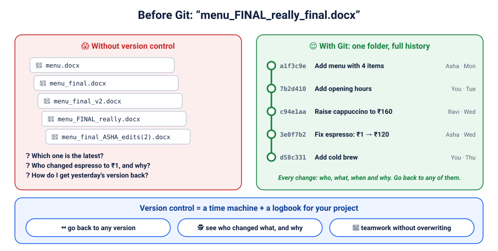
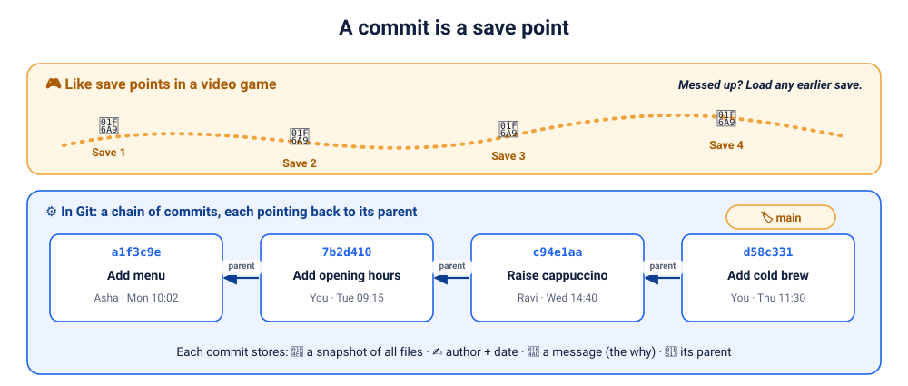
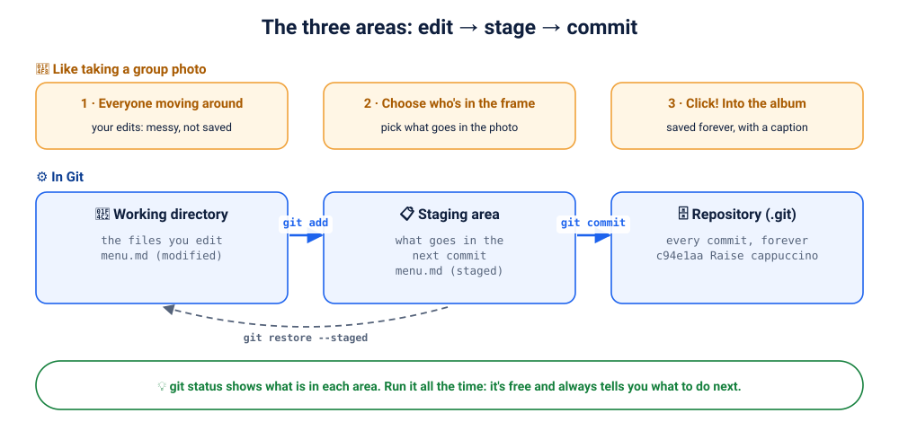
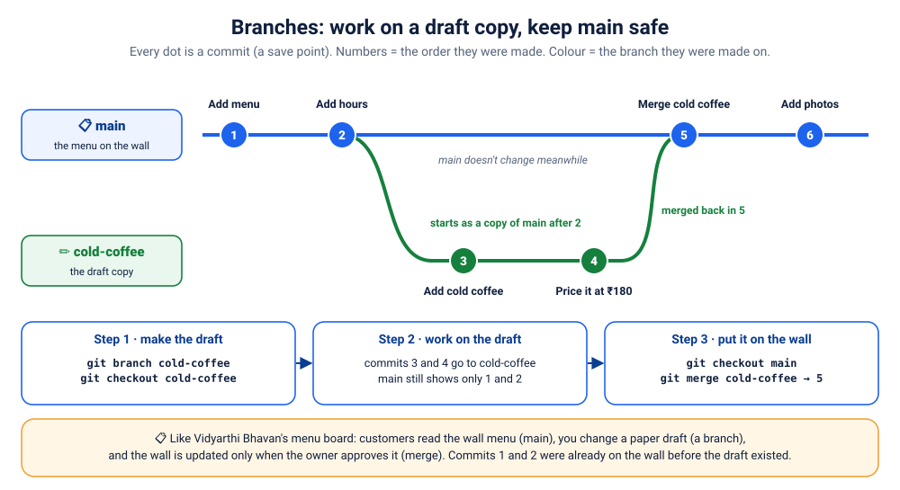
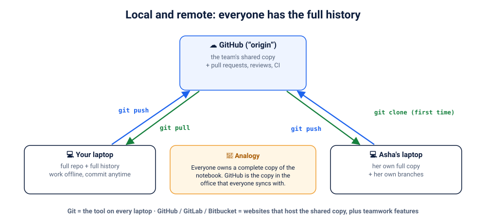
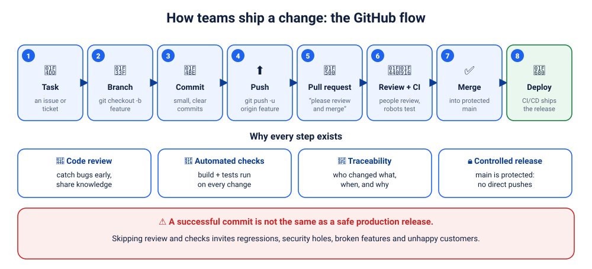
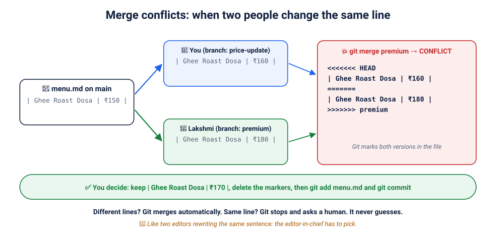
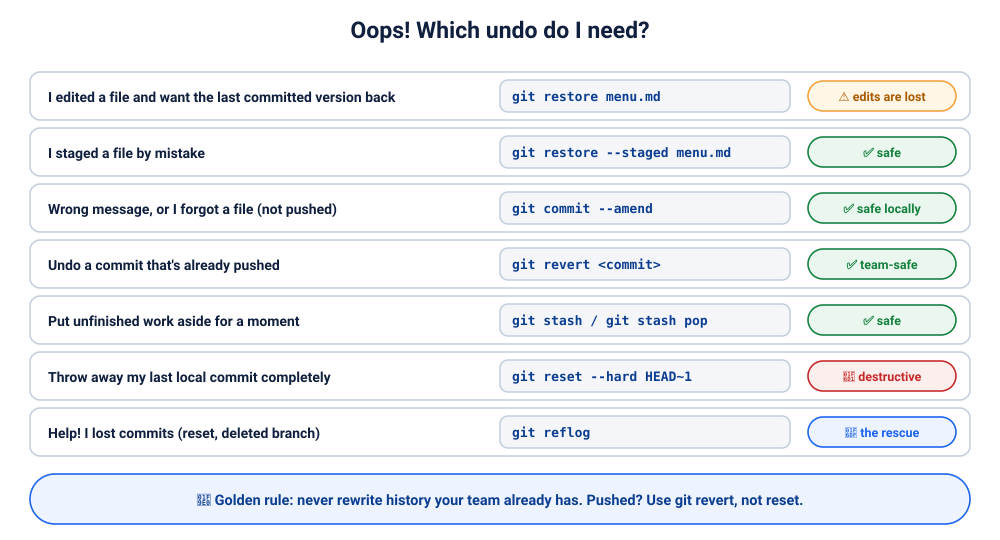
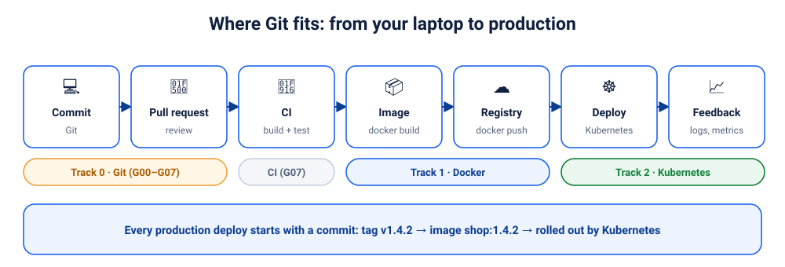

# Lab G00: Git Foundations: Why Every Change Starts with Git

> ⏱ 60–90 min · 🟢 Absolute beginner · no Git knowledge needed · hands-on starts in [G01](../01-first-repo/README.md)

Every app you'll containerise in Track 1 and run on Kubernetes in Track 2 starts life as a **commit**. This module explains the **why** and the **mental model** in pictures. The labs that follow let you *live* it, as a new developer at **Vidyarthi Bhavan** 🥞, Bengaluru's legendary breakfast spot in Basavanagudi (serving benne dosas since 1943). *The website, team, prices and incidents in these labs are invented for teaching; they are not the restaurant's real systems.*

By the end you'll be able to explain, without notes:
- what problem version control solves, and the difference between Git and GitHub
- what a commit, the staging area, a branch and a remote are
- how real teams ship a change: branch → pull request → review → CI → merge
- why merge conflicts happen, and which "undo" to use when

<details><summary>📑 Contents</summary>

1. [The problem: "resume_FINAL_really.docx"](#1-the-problem-resume_final_reallydocx)
2. [Git in one sentence, and Git vs GitHub](#2-git-in-one-sentence-and-git-vs-github)
3. [Commits: save points](#3-commits-save-points)
4. [The three areas: edit → stage → commit](#4-the-three-areas-edit--stage--commit)
5. [Branches: a safe draft copy](#5-branches-a-safe-draft-copy)
6. [Local and remote: everyone has the full history](#6-local-and-remote-everyone-has-the-full-history)
7. [How real teams ship a change](#7-how-real-teams-ship-a-change)
8. [Merge conflicts](#8-merge-conflicts)
9. [Oops! Which undo do I need?](#9-oops-which-undo-do-i-need)
10. [The big picture: Git → Docker → Kubernetes](#10-the-big-picture-git--docker--kubernetes)
11. [Recap, the final challenge, and the quiz](#11-recap-the-final-challenge-and-the-quiz)
</details>

---

## 1. The problem: "resume_FINAL_really.docx"



Open your Downloads folder. Be honest. 😄

```
resume.docx
resume_final.docx
resume_final_v2.docx
resume_FINAL_really.docx
resume_final_mom_edits(2).docx
```

- **Which one did you send to the recruiter** last time when you applied for internship/job?
- **What did you change** for the DevOps role, and why?
- Your mentor fixed a typo, but in **which copy**?
- How do you get back the version from **before** you deleted that internship?

That's life **without version control**. With Git, there's **one** `resume.md` and a history that answers every one of those questions: each change saved with **who, what, when and why**, and you can jump back to any of them.

### Now multiply that by a whole team 👥

It was a chaotic Monday morning at **Vidyarthi Bhavan** in Basavanagudi.
Online orders were exploding on Swiggy and Zomato. Customers weren't just ordering their usual breakfasts, they were buying 20 to 30 benne dosas at a time.
At first, the proud management thought their legendary reputation had reached a new peak. Then they checked the website.

Bengaluru’s most famous iconic crispy dosas were accidentally selling for just ₹1.🥞😱

> 👩‍💼 **Owner:** Who changed the price?
> 👩‍💻 **Lakshmi:** Not me. I only fixed the opening hours.
> 🧑‍🎓 **Ravi (intern):** I just… tidied up the formatting?

When several people edit the same files, nobody knows **which version is current, who changed what, or how to get yesterday's version back**, and someone's work gets overwritten every week. (You'll solve this exact mystery in G02.)

> 🧠 **Remember:** version control is a **time machine plus a logbook** for your project.

---

## 2. Git in one sentence, and Git vs GitHub

> **Git** is a tool that records every change to your project as a **snapshot**, with who made it, when, and why, so you can go back in time and many people can work on the same files without overwriting each other.

| | Git | GitHub (or GitLab, Bitbucket) |
|---|---|---|
| What | a **tool** on your computer | a **website** that hosts Git repositories |
| Works offline? | yes, completely | no |
| Gives you | history, branches, merging | a shared copy, plus **pull requests, code review, issues, CI (Actions)** |
| Analogy | 📸 the **camera** that takes the photos | 🖼️ the **shared online album** where the team views and comments on them |

📜 *A tiny bit of history:* Linus Torvalds (who created Linux) wrote Git in **2005**, in about two weeks, to manage the Linux kernel's thousands of contributors. GitHub launched in **2008**. Today Git is used by the vast majority of software teams on Earth.

---

## 3. Commits: save points



- A **commit** is a **save point** of your whole project, like in a video game. Mess up later? Load any earlier save.
- Each commit stores a **snapshot of all files**, the **author and date**, a **message** explaining *why*, and a link to its **parent** (the previous commit).
- Every commit gets a unique ID such as `c94e1aa` (short for a 40-character hash).

> 🧠 **Remember:** commit **early**, commit **often**, one idea per commit, and write messages your future self will thank you for. `Raise ghee roast dosa to ₹160 (milk prices)` beats `update`.

---

## 4. The three areas: edit → stage → commit



Think of taking a **group photo** 📸:
1. **Working directory**: everyone is moving around. These are the files you're editing, messy and not yet saved.
2. **Staging area**: you choose **who's in the frame**. `git add` picks *exactly* which changes go into the next commit.
3. **Repository**: *click!* `git commit` saves the photo in the album forever, with a caption (the message).

Why the middle step? Because you often change five things but want to save them as **two clean, separate commits**.

> 🧠 **Remember:** `git status` tells you what's in each area **and what to do next**. Run it constantly.

---

## 5. Branches: a safe draft copy



**How to read the picture.** Every dot is a commit, numbered in the order it was made. Its colour (and its lane) tells you **which branch it was made on**.
- **1 "Add menu"** and **2 "Add hours"** are ordinary commits on **`main`**. They happened *before* any draft existed.
- Right after 2, you create **`cold-coffee`**. It starts as an **exact copy of `main` at that moment**, so it already contains 1 and 2. That's why the green line grows out of dot 2.
- **3** and **4** are made **only on `cold-coffee`**. Meanwhile `main` still shows just 1 and 2: customers never see the half-finished cold coffee.
- **5** merges the draft into `main`. Now `main` has the cold coffee too.
- **6** is a normal commit on `main` again.

Picture the **menu board on the wall** at Vidyarthi Bhavan 📋. Customers order from it all day, so nobody scribbles on it directly. Changing the menu takes three steps:

| Step | At Vidyarthi Bhavan | In Git |
|---|---|---|
| 1 | ✏️ make a **draft copy** of the menu on paper | `git branch cold-coffee`, then `git checkout cold-coffee` *(shortcut: `git checkout -b cold-coffee`)* |
| 2 | work on the draft as long as you like; the wall menu doesn't change | commit on the branch; `main` doesn't change |
| 3 | owner approves → the **wall menu is updated** | `git checkout main`, then `git merge cold-coffee` |

- **`main`** is the menu on the wall: the version everyone trusts, and it should always work.
- You can have **many drafts at once**, one per feature or fix, without disturbing each other.
- **HEAD** is the "📍 you are here" marker: the branch you're working on right now. `git checkout <branch>` moves you, and the files in your folder change to match.

> 🧠 **Remember:** never scribble on the wall menu. **Branch → work → merge.**

> 🔀 **`git checkout` or `git switch`?** Both move between branches: `git checkout -b x` = `git switch -c x`. `switch` is the newer name (Git 2.23+). You'll see both at work. Comparison: [G03](../03-branches/README.md#-git-checkout-vs-git-switch-know-both) · [cheat sheet](../../cheatsheets/git.md)

<details><summary>🔎 Under the hood (for the curious)</summary>

A branch isn't a copy of your files. It's just a **name that points at a commit**, and that pointer moves forward every time you commit on the branch. That's why creating a branch is instant, even in a huge project.
</details>

---

## 6. Local and remote: everyone has the full history



- Git is **distributed**: your laptop has the **complete** history, so you can commit on a plane with no internet.
- The team agrees on one **shared copy**, usually on GitHub, called **`origin`**.
- `git clone` copies it once; `git push` sends your commits up; `git pull` brings others' commits down.

> 🧠 **Remember:** a commit on your laptop is **invisible to the team** until you `git push` it.

---

## 7. How real teams ship a change



Nobody at a serious company pushes straight to `main`. The **GitHub flow** (used, with small variations, almost everywhere):

1. **Task**: an issue or ticket says what to do
2. **Branch**: `git branch feature/combo-offers` + `git checkout feature/combo-offers` (or both at once: `git checkout -b feature/combo-offers`)
3. **Commit**: small, clear commits
4. **Push**: `git push -u origin feature/combo-offers`
5. **Pull request (PR)**: "please review and merge my branch"
6. **Review + CI**: teammates comment; robots build and test automatically
7. **Merge** into a **protected** `main` (direct pushes are blocked)
8. **Deploy**: CI/CD releases what's on `main`

> 🧠 **Remember:** a successful commit is **not** the same as a safe production release. Reviews and automated checks are what get you from one to the other.

---

## 8. Merge conflicts



- You and Lakshmi both change the **same line** (the ghee roast dosa price) on different branches.
- **Different lines?** Git merges them automatically. **Same line?** Git **stops and asks a human**. It never guesses.
- Git writes both versions into the file between `<<<<<<<`, `=======` and `>>>>>>>` markers. You pick the final text, delete the markers, then `git add` and `git commit`.

> 🧠 **Remember:** a conflict isn't an error. It's Git saying **"you two need to talk."** Pull often and keep branches small, and conflicts stay rare and tiny.

---

## 9. Oops! Which undo do I need?



You don't need to memorise this table. Remember **two rules**:
1. **Not pushed yet?** You can rewrite freely: `restore`, `--amend`, `reset`.
2. **Already pushed?** Never rewrite history others have. Add a new commit that undoes it: **`git revert`**.

And if you ever think you lost work: **`git reflog`** remembers everywhere you've been. Git almost never truly deletes a commit.

---

## 10. The big picture: Git → Docker → Kubernetes



This is the end-to-end flow from the class slides:
**source (Git) → CI (build, test, scan) → registry (versioned image) → deploy → feedback.**

The **Git tag** `v1.4.2` becomes the **Docker image** `shop:1.4.2`, which **Kubernetes** rolls out. That's why this course starts here.

---

## 11. Recap, the final challenge, and the quiz

### 🧠 The whole module on one card
```
PROBLEM     which version? who changed it? how do I go back? who overwrote my work?
GIT         a time machine + logbook (tool, offline) · GitHub = shared album + teamwork
COMMIT      a save point: snapshot + author + date + message + parent
3 AREAS     working dir --git add--> staging --git commit--> repository   (git status!)
BRANCH      a safe draft copy: branch → work → merge; main = the menu on the wall
REMOTE      origin = the team's shared copy · clone · push · pull
TEAM FLOW   task → branch → commit → push → PR → review + CI → merge → deploy
CONFLICT    same line, two changes → a human decides
UNDO        not pushed: rewrite freely · pushed: git revert · lost: git reflog
```

### 🏆 Final challenge: explain Git to a 10-year-old in 3 minutes
Cover: save points, branches as "trying something on a copy", and why the team doesn't all edit the same file at once.

<details><summary>💬 One possible answer</summary>

> "You know how video games let you **save** before a hard level, so you can go back if you lose? Git does that for a project: every time you save, it remembers exactly what everything looked like, who saved it, and why.
>
> When you want to try something risky, you make a **branch**: like doing your experiment on a photocopy of your homework. If it works, you copy it back into the real one. If it doesn't, you throw the copy away. Nothing was harmed.
>
> And when lots of people work on the same project, everyone has their own full copy. They send their changes to one shared place, and a friend checks the changes before they go in. If two people changed the very same sentence, Git asks them to decide together, instead of one person's work silently disappearing."
</details>

### 📝 Test yourself
**[Take the G00 quiz →](quiz.md)** 30 questions with answers.

➡️ **Next:** [G01: Day 1: Your First Repository](../01-first-repo/README.md). Time to open a terminal and start working at Vidyarthi Bhavan.
