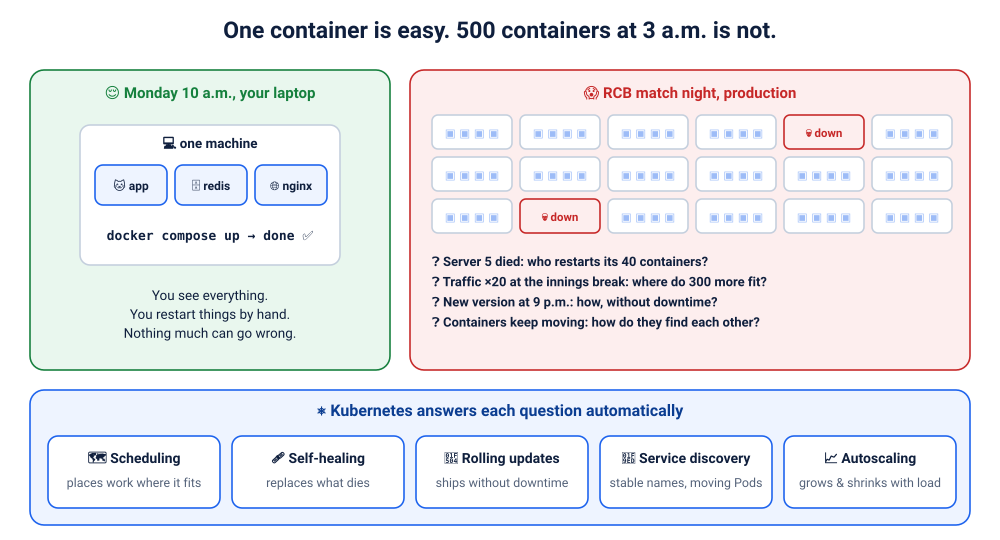
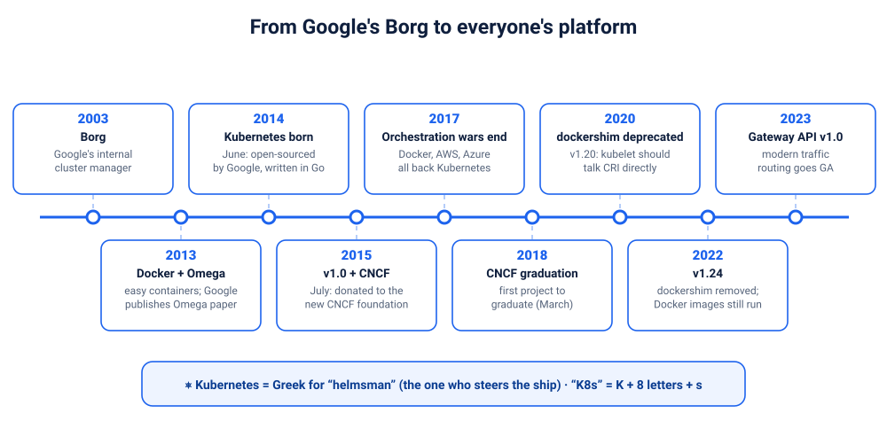
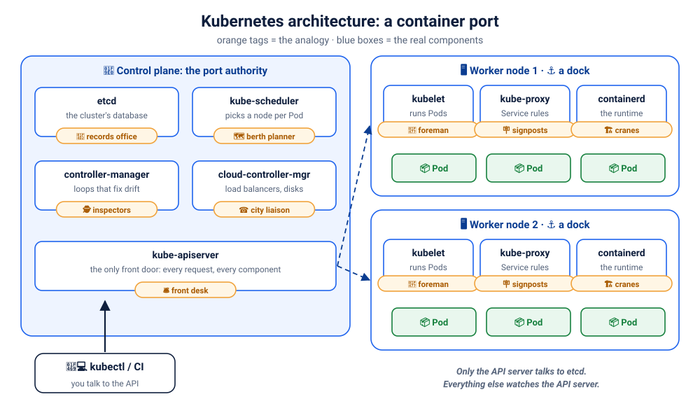
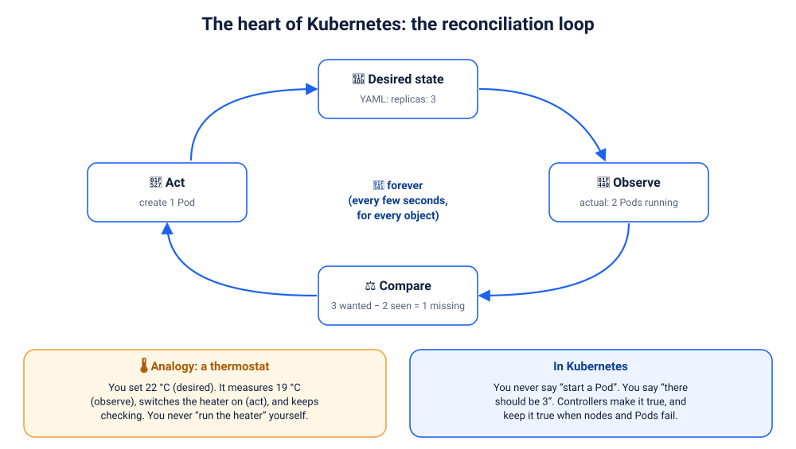
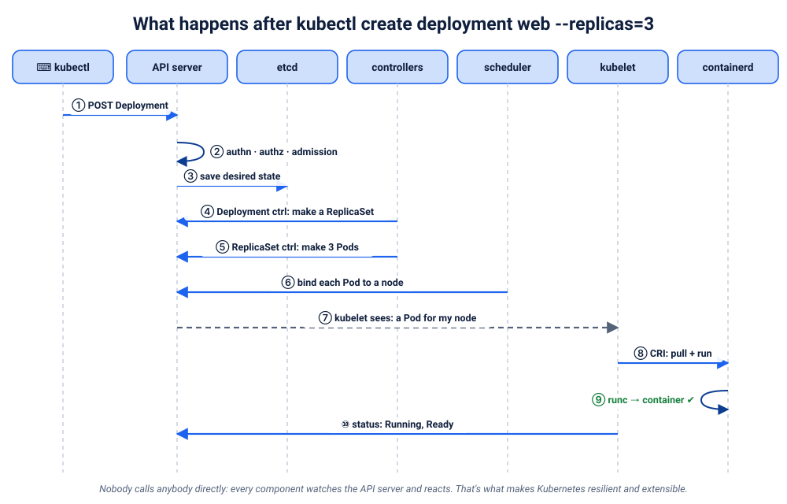
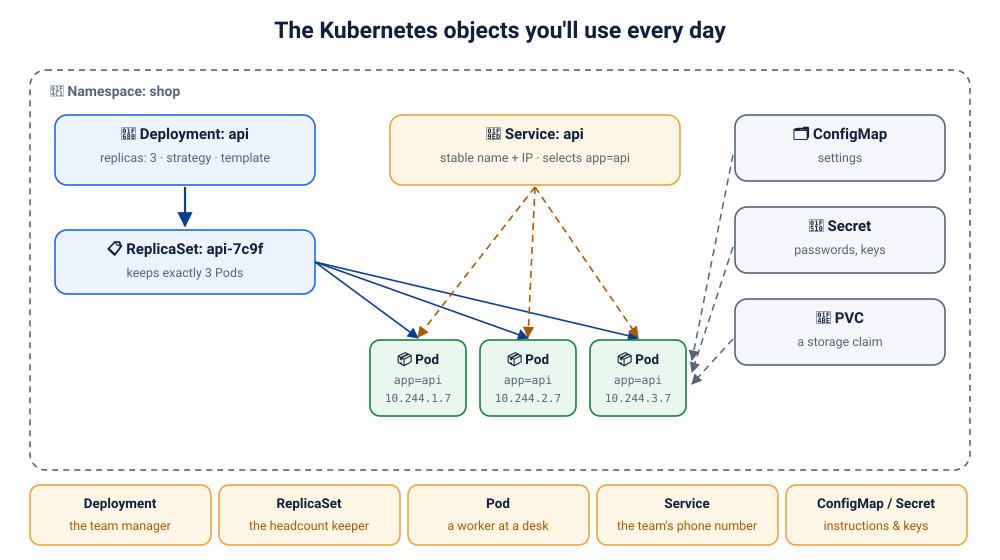
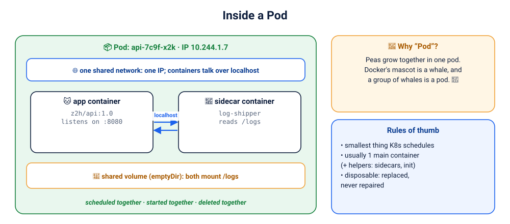
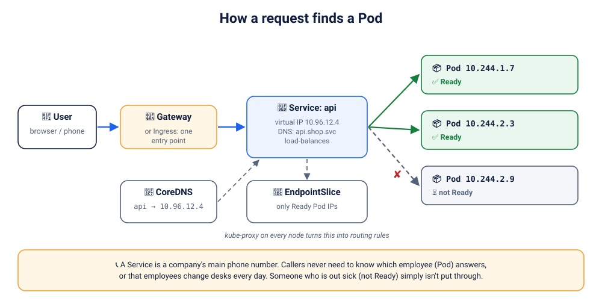
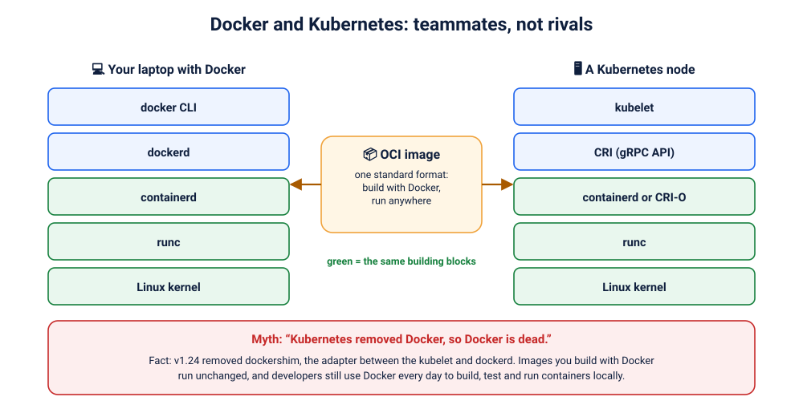

# Lab K00: Kubernetes Foundations: Why Orchestration Exists and How Kubernetes Thinks

> ⏱ 2.5–3 hours · 🟢 Beginner · assumes you've done [D00 Docker Foundations](../../docker/00-foundations/README.md) · 🧪 hands-on parts need a cluster ([setup](../../00-setup/README.md))

By the end of this module you will be able to explain, **in your own words**:

- why running containers on **many** machines needs an orchestrator
- where Kubernetes came from, and why the industry chose it
- what every control-plane and node component does, using a container-port analogy
- the single most important idea in Kubernetes: **desired state and reconciliation**
- what happens, step by step, after `kubectl create deployment`
- how Pods, Deployments, Services and friends fit together, and how a request finds its Pod
- how Docker and Kubernetes relate (and why "Kubernetes killed Docker" is a myth)

Same rhythm as D00: **Explain → Illustrate → Relate → Map to the real thing → Prove it → Quick check ⚡**

<details><summary>📑 Contents</summary>

1. [The problem: one container is easy](#1-the-problem-one-container-is-easy)
2. [Orchestration in one sentence](#2-orchestration-in-one-sentence)
3. [Where Kubernetes came from](#3-where-kubernetes-came-from)
4. [Architecture: the container port](#4-architecture-the-container-port)
5. [The big idea: desired state and reconciliation](#5-the-big-idea-desired-state-and-reconciliation)
6. [What happens after `kubectl create deployment`](#6-what-happens-after-kubectl-create-deployment)
7. [The objects you'll use every day](#7-the-objects-youll-use-every-day)
8. [Pods up close](#8-pods-up-close)
9. [How a request finds a Pod](#9-how-a-request-finds-a-pod)
10. [Docker and Kubernetes: teammates, not rivals](#10-docker-and-kubernetes-teammates-not-rivals)
11. [Your first 15 kubectl commands, explained](#11-your-first-15-kubectl-commands-explained)
12. [Myths, busted](#12-myths-busted)
13. [Recap, the final challenge, and the quiz](#13-recap-the-final-challenge-and-the-quiz)
</details>

---

## 1. The problem: one container is easy



On your laptop, Docker is wonderful. `docker compose up`, and three containers are running. You can see them all, restart them by hand, and nothing much goes wrong.

Now imagine you're the engineer for a food-delivery app on **cricket-final night**. 🏏

> 📟 **3:07 a.m. pager:** "Server 5 is down."
> 😴 **You:** Which containers were on server 5?
> 📟 Forty of them. Some were the payment service.
> 😰 **You:** Which servers have room for 40 containers?
> 📟 Not sure. Also, traffic will jump 20× at the innings break.
> 😱 **You:** And the release scheduled for 9 p.m.?
> 📟 Still half-deployed. Half the users see the old checkout, half the new one.
> 💀 **You:** …and how does the checkout service find the payment service now that it's on a different machine?

With 500 containers on 50 servers, **humans can't keep up**. You need software that:

| Question | What it needs to do | Kubernetes calls it |
|---|---|---|
| Where should this container run? | find a machine with enough free CPU and memory | **scheduling** |
| A container or machine died. Now what? | notice and replace it, automatically | **self-healing** |
| How do we ship v2 without downtime? | replace containers gradually, roll back if broken | **rolling updates** |
| Containers move. How do services find each other? | give them stable names and load-balance between them | **service discovery** |
| Traffic jumped 20×! | add containers (and machines), remove them later | **autoscaling** |
| Where do passwords and config go? | deliver them safely to the right containers | **ConfigMaps & Secrets** |
| What about the database's data? | attach storage that follows the container | **persistent volumes** |

### ⚡ Quick check
<details><summary>Docker already restarts crashed containers (restart policies). Why isn't that enough?</summary>

Docker manages **one machine**. If the whole machine dies, nothing on it restarts anywhere else. Docker also doesn't decide which of 50 machines has room, roll out versions across all of them, or give services stable names across machines. Those are cluster-wide jobs.
</details>

---

## 2. Orchestration in one sentence

> **Container orchestration** means automatically deploying, scaling, connecting, healing and updating containers across a **cluster** of machines, so you describe *what* you want and the system works out *how*, and keeps it that way.

**Kubernetes** is the most widely used open-source container orchestrator. You give it a description, such as "3 copies of this app, reachable at this name, with these limits", and it makes that true, **continuously**.

---

## 3. Where Kubernetes came from



- **2003–2004: Borg.** Google built an internal system to run *everything* (Search, Gmail, Maps) as containers across huge clusters. A decade of lessons about running containers at scale went into it.
- **2013: Docker and Omega.** Docker made containers easy for everyone, and Google published research on Omega, Borg's successor.
- **June 2014: Kubernetes is open-sourced.** Google engineers (Joe Beda, Brendan Burns and Craig McLuckie, joined by many others) took Borg's ideas, rewrote them in Go, and released them for everyone.
- **July 2015: v1.0 and the CNCF.** Google donated Kubernetes to the new **Cloud Native Computing Foundation**, so no single company owns it.
- **2017: the "orchestration wars" end.** Docker Swarm, Mesos and others competed; by late 2017 Docker, AWS and Azure all offered Kubernetes.
- **2018:** Kubernetes becomes the **first graduated CNCF project**.
- **2020–2022:** Kubernetes stops using Docker's daemon (**dockershim**) and talks to runtimes like containerd directly. Images built with Docker still run unchanged (chapter 10).
- **Today:** every major cloud offers managed Kubernetes (EKS, GKE, AKS), and it runs everywhere from laptops to cars to factories.

> ⎈ **The name.** *Kubernetes* is Greek for **helmsman**: the person who steers the ship. That's why the logo is a ship's wheel. **K8s** = K + 8 letters + s. Docker's mascot is a whale carrying containers; Kubernetes steers the ship.

### Why did Kubernetes win?
- **Battle-tested ideas** from Google's decade of Borg
- **Open governance** under the CNCF: no vendor lock-in
- **Declarative API**: describe what you want, not how to get it
- **Extensibility**: you can add your own object types and controllers (operators)
- **A huge ecosystem**: Helm, Argo CD, Prometheus, Istio, and thousands more

---

## 4. Architecture: the container port

Docker gave us standard **containers**. Kubernetes is the **port** that handles thousands of them every day.



A **cluster** has two kinds of machines:
- the **control plane**: the *brain*. It decides what should happen.
- **worker nodes**: the *muscle*. Your containers actually run here.

### The control plane: the port authority 🏛️

| Component | Port analogy | What it really does |
|---|---|---|
| **kube-apiserver** | 🛎️ the **front desk**: every request goes through it | the only entry point. It checks who you are (authentication), whether you're allowed (authorisation) and whether the request is valid (admission), then stores it. Every component talks *only* to the API server. |
| **etcd** | 📒 the **records office**: the official ledger | a reliable key-value database holding the **entire** cluster state: desired and actual. Only the API server talks to it. Back it up! |
| **kube-scheduler** | 🗺️ the **berth planner**: which dock gets which ship | watches for new Pods with no node, then picks the best node using free resources, rules and spreading. It only *decides*; the kubelet *starts*. |
| **kube-controller-manager** | 🕵️ the **inspectors** who fix anything that doesn't match the ledger | runs dozens of **controllers** (Deployment, ReplicaSet, Node, Job…), each a loop: compare desired with actual, then act. |
| **cloud-controller-manager** | ☎️ the **liaison with the city** | talks to the cloud provider: creates load balancers, attaches disks, notices deleted VMs. Not present on local clusters such as kind or Docker Desktop. |

### Worker nodes: the docks ⚓

| Component | Port analogy | What it really does |
|---|---|---|
| **kubelet** | 👷 the **dock foreman** | an agent on every node. It watches the API server for Pods assigned to *its* node, tells the runtime to start them, runs their health checks, and reports status back. |
| **container runtime** (containerd, CRI-O) | 🏗️ the **cranes** that actually move containers | pulls images and runs containers. The kubelet talks to it through the **CRI** (Container Runtime Interface). Under the hood: runc, exactly as in D00. |
| **kube-proxy** | 🪧 the **signposts** that route traffic | programs each node's networking (iptables/IPVS, or replaced by eBPF in some setups) so that a **Service** address reaches the right Pods. |

### Add-ons you'll meet
- **CoreDNS**: the cluster's phone book (`redis` → `10.96.12.4`)
- **CNI plugin** (Calico, Cilium, Flannel, kindnet…): gives every Pod an IP and connects Pods across nodes; may enforce NetworkPolicies
- **CSI drivers**: connect storage systems (cloud disks, NFS…) for persistent volumes
- **metrics-server**: CPU and memory numbers for `kubectl top` and autoscaling

> 🧠 **Golden rule:** nobody talks to anybody directly. Everything goes **through the API server**, and only the API server touches etcd. That's why you can add, replace or restart components without the cluster falling apart.

### 🔬 Meet your cluster
```bash
kubectl cluster-info
kubectl get nodes -o wide
kubectl get pods -n kube-system -o wide
```
In `kube-system` you'll see the control plane **running as Pods**: `etcd-…`, `kube-apiserver-…`, `kube-scheduler-…`, `kube-controller-manager-…`, plus `coredns-…`, `kube-proxy-…` and a CNI agent. **Kubernetes runs on Kubernetes.** (On managed clouds the control plane is hidden; you only see your nodes.)

### ⚡ Quick check
<details><summary>1. Which component decides <i>where</i> a Pod runs, and which one actually <i>starts</i> it?</summary>

The **kube-scheduler** decides (it writes the node name onto the Pod). The **kubelet** on that node starts it, through the container runtime.
</details>
<details><summary>2. Where does Kubernetes store "there should be 3 replicas"?</summary>

In **etcd**, written there by the **API server**. No other component writes to etcd directly.
</details>

---

## 5. The big idea: desired state and reconciliation

If you remember only one thing from this module, make it this chapter.

### Imperative vs declarative: the taxi 🚕

- **Imperative:** "Drive 200 m, turn left, take the second exit, turn right at the temple…" You must know every step. If there's a roadblock, you're stuck.
- **Declarative:** "Take me to the airport." You state the **destination**; the driver works out the route and re-routes around roadblocks.

Docker commands are mostly **imperative** ("run this container now"). Kubernetes is **declarative**: you write *what you want* in YAML, and Kubernetes works out how and keeps it true.

### The reconciliation loop 🔁



**Analogy: a thermostat.** 🌡️ You set 22 °C. The thermostat measures 19 °C, switches the heater on, keeps measuring, and turns the heater off at 22 °C. If someone opens a window, it reacts again. **You never switch the heater on yourself.**

**In Kubernetes,** every controller runs the same loop, forever:
```
1. DESIRED  what the YAML says        → replicas: 3
2. OBSERVE  what actually exists       → 2 Pods running (a node died)
3. COMPARE  what's the difference?     → 1 missing
4. ACT      make reality match         → create 1 Pod
   …and start again
```
This one idea explains self-healing, scaling, rolling updates, and why "just delete the Pod" is a valid troubleshooting step.

> ⚠️ Desired state is **reconciled, not magically guaranteed.** If no node has room, the new Pod waits in `Pending`. Kubernetes keeps *trying*, and tells you why it can't succeed (`kubectl describe`).

### 🔬 Prove it: try to defeat the loop
```bash
kubectl create deployment web --image=nginx:1.27-alpine --replicas=3
kubectl get pods -l app=web -w          # leave this running in terminal 2
```
In terminal 1, delete everything, as fast as you like:
```bash
kubectl delete pod -l app=web --wait=false
```
Within seconds, three **new** Pods (new names) appear. You can't win: the ReplicaSet controller is faster than you. 😄
```bash
kubectl get events --sort-by=.metadata.creationTimestamp | tail -8     # see the controller's actions
kubectl delete deployment web                                          # change the DESIRED state instead
```

### ⚡ Quick check
<details><summary>Someone runs <code>kubectl delete pod</code> on a Pod owned by a Deployment "to stop the app". Why doesn't it stop?</summary>

They changed the **actual** state, not the **desired** state. The controller sees 2 Pods where 3 are wanted and creates a replacement. To stop the app, change the desired state: scale to 0, or delete the Deployment.
</details>

---

## 6. What happens after `kubectl create deployment`



| Step | Who | What happens |
|---|---|---|
| ① | **kubectl** | turns your command (or YAML) into an HTTP request to the API server, using your **kubeconfig** for the address and credentials |
| ② | **API server** | **authentication** (who are you?), **authorisation/RBAC** (may you?), **admission** (is it valid and allowed, e.g. Pod Security?) |
| ③ | **API server → etcd** | stores the Deployment: the **desired state** now exists. kubectl prints `deployment.apps/web created`. *Nothing is running yet!* |
| ④ | **Deployment controller** | sees a new Deployment with no ReplicaSet, so it creates one |
| ⑤ | **ReplicaSet controller** | sees "want 3, have 0", so it creates 3 Pod objects (with no node yet) |
| ⑥ | **scheduler** | sees unscheduled Pods, scores the nodes, and **binds** each Pod to a node |
| ⑦ | **kubelet** (on that node) | sees "a Pod is assigned to me" |
| ⑧ | **kubelet → containerd** (CRI) | pull the image if needed, create the Pod's network sandbox (via the CNI plugin), start the containers |
| ⑨ | **containerd → runc → kernel** | namespaces, cgroups, start the process: exactly the D00 chain |
| ⑩ | **kubelet → API server** | reports status: `Running`, then `Ready` once the readiness checks pass |

> 🧠 Notice that **no component calls another directly**. Each one *watches* the API server for changes and reacts. Kill the scheduler for a minute and nothing breaks: Pods simply wait, and it catches up when it returns.

### 🔬 Watch the chain reaction
```bash
kubectl get events -w &                 # stream events in the background
kubectl create deployment chain --image=nginx:1.27-alpine --replicas=2
sleep 15; kill %1
```
You'll see the controllers (`ScalingReplicaSet`, `SuccessfulCreate`), the scheduler (`Scheduled … to node`) and the kubelet (`Pulling`, `Pulled`, `Created`, `Started`), in that order.
```bash
kubectl delete deployment chain
```

---

## 7. The objects you'll use every day



| Object | Analogy | What it is |
|---|---|---|
| **Pod** | a worker at a desk | the smallest thing Kubernetes runs: one or more tightly coupled containers sharing an IP and volumes |
| **ReplicaSet** | the headcount keeper | keeps exactly *N* identical Pods running. You rarely create one directly |
| **Deployment** | the team manager | manages ReplicaSets: desired replicas, rolling updates, rollbacks. **This is what you normally create** for stateless apps |
| **Service** | the team's phone number | a stable name and virtual IP in front of a changing set of Pods, chosen by **labels** |
| **Namespace** | a department / floor | a folder for objects; the unit for access control and quotas |
| **ConfigMap** | the instruction sheet | non-secret configuration, delivered as env vars or files |
| **Secret** | the key cabinet | passwords, tokens and keys (base64-encoded, not encrypted by default) |
| **PersistentVolumeClaim** | a storage locker request | "I need 1 GiB of disk"; the cluster provides it and it outlives Pods |
| **Node** | a dock | a machine (VM or physical) that runs Pods |

Also coming in the labs: **StatefulSet** (databases), **DaemonSet** (one Pod per node), **Job/CronJob** (run to completion), **Ingress/Gateway** (HTTP entry points), **HorizontalPodAutoscaler**.

### Every object has the same shape
```yaml
apiVersion: apps/v1        # which API group and version defines this kind
kind: Deployment           # what type of object
metadata:                  # identity: name, namespace, labels
  name: web
  labels: { app: web }
spec:                      # DESIRED state: you write this
  replicas: 3
  selector: { matchLabels: { app: web } }
  template: { … a Pod template … }
status:                    # ACTUAL state: Kubernetes writes this
  readyReplicas: 3
```
> 🧠 **`spec` is your wish. `status` is reality.** Controllers spend their whole lives making `status` match `spec`.

### Labels: the glue 🏷️
Deployments find their Pods, and Services find their endpoints, **by labels**, not by names. `app=web` on a Pod, `selector: app=web` on a Service. One typo and the Service silently routes to nothing. (You'll break this on purpose in Lab K05.)

---

## 8. Pods up close



A **Pod** is a small group of containers that are **scheduled together, started together and deleted together** on one node. Inside a Pod, containers:
- share **one network identity**: one IP, and they reach each other on `localhost`
- can share **volumes**: for example, an app writes logs that a sidecar ships elsewhere

**Why not just "a container"?** Because some helpers must live right next to the app: log shippers, proxies, config reloaders. The Pod is the wrapper that keeps them together.

> 🫛 **Why "Pod"?** Like peas in a pod. And since Docker's mascot is a whale, a group of whales is a pod. 🐳

**Rules of thumb:**
- usually **one main container per Pod** (plus optional sidecars and init containers)
- Pods are **disposable**: you never repair a Pod, you let the controller replace it
- **never rely on a Pod's IP or name**: both change on replacement. Use a Service.
- you almost never create bare Pods; you create **Deployments**, which create Pods

---

## 9. How a request finds a Pod



1. **Every Pod gets its own IP** (the CNI plugin provides it). Any Pod can reach any other Pod's IP directly: a flat network.
2. But Pod IPs **change** whenever Pods are replaced, so clients use a **Service**: a stable **virtual IP** plus a **DNS name** like `api.shop.svc.cluster.local`.
3. **CoreDNS** resolves the name to the Service IP.
4. The Service's **EndpointSlices** list the IPs of the matching Pods that are **Ready**.
5. **kube-proxy** on each node turns this into routing rules, so traffic to the Service IP lands on one of those Pods (load-balanced).
6. From outside the cluster, traffic usually enters through a **Gateway or Ingress** (one entry point), or a `NodePort` / `LoadBalancer` Service.

> 📞 **Analogy:** a Service is a company's **main phone number**. Callers never need to know which employee (Pod) answers, or that employees change desks every day. Someone who is out sick (**not Ready**) simply isn't put through.

---

## 10. Docker and Kubernetes: teammates, not rivals



| | Docker | Kubernetes |
|---|---|---|
| Scope | **one machine** | a **cluster** of many machines |
| Main job | build, ship and run containers | schedule, heal, scale, connect and update containers |
| Style | mostly imperative commands | declarative desired state |
| You use it to | build images, run things locally, CI | run production workloads at scale |

They share the **same building blocks**: OCI images, containerd, runc, the Linux kernel. The difference is who's in charge: **dockerd** on your laptop, the **kubelet** (through the CRI) on a Kubernetes node.

### The "Kubernetes removed Docker" story, told properly
- Early Kubernetes talked to Docker's daemon through an adapter called **dockershim**.
- Kubernetes later standardised on the **CRI** (Container Runtime Interface), which containerd and CRI-O implement natively.
- v1.20 (2020) deprecated dockershim; **v1.24 (2022) removed it**.
- **What changed for you: almost nothing.** Images built with `docker build` are standard OCI images and run on any cluster. You still use Docker every day to build and test. Only cluster operators had to switch the node runtime to containerd or CRI-O (or use the separately maintained `cri-dockerd` adapter).

---

## 11. Your first 15 kubectl commands, explained

`kubectl` (say "cube-control" or "cube-cuttle"; both are fine) is **the waiter of Kubernetes**: every command becomes a request to the **API server**.

| # | Command | What & why | What happens inside | Expect |
|---|---|---|---|---|
| 1 | `kubectl version` | client and server versions: is the cluster reachable? | `GET /version` | `Client Version` + `Server Version` (more than ±1 minor apart prints a warning) |
| 2 | `kubectl config current-context` | **which cluster am I talking to?** Run it before anything risky | reads `~/.kube/config` locally, no API call | e.g. `docker-desktop`, `kind-z2h` |
| 3 | `kubectl cluster-info` | API server address, plus CoreDNS | API discovery | `Kubernetes control plane is running at https://…` |
| 4 | `kubectl get nodes -o wide` | the machines, their status, IPs, OS and runtime | `GET /api/v1/nodes` | `Ready`, version, `containerd://…` |
| 5 | `kubectl get pods -A` | every Pod in every namespace | list Pods across namespaces | the system Pods in `kube-system` |
| 6 | `kubectl api-resources` | every object type this cluster understands | API discovery | pods, services, deployments… with short names (`po`, `svc`, `deploy`) |
| 7 | `kubectl explain deployment.spec` | built-in documentation for any field | reads the API's OpenAPI schema | field descriptions; add `--recursive` for the full tree |
| 8 | `kubectl create deployment web --image=nginx:1.27-alpine --replicas=3` | create the desired state | the whole chapter 6 chain | `deployment.apps/web created` |
| 9 | `kubectl get deploy,rs,pods -l app=web` | see the Deployment → ReplicaSet → Pods family | three list calls filtered by label | `READY 3/3`, one RS, three Pods |
| 10 | `kubectl describe pod <name>` | everything about one object, **plus its Events** | reads the object and its related events | read Events bottom-up: `Scheduled → Pulled → Started` |
| 11 | `kubectl logs <pod>` (`-f`, `--previous`) | what the container printed | the kubelet streams the container's stdout/stderr | nginx start-up lines |
| 12 | `kubectl exec -it <pod> -- sh` | a shell inside a running container | kubelet → runtime starts a process in the container's namespaces | a `/ #` prompt; `exit` to leave |
| 13 | `kubectl expose deployment web --port=80` | give the Pods a stable Service | creates a Service whose selector is `app=web` | `service/web exposed` |
| 14 | `kubectl port-forward svc/web 8080:80` | reach a Service from your laptop for debugging | an API-server tunnel to one backing Pod | open http://localhost:8080 |
| 15 | `kubectl scale deployment web --replicas=5` / `kubectl delete deployment web` | change the desired state | updates `spec.replicas` / deletes the Deployment (its RS and Pods follow) | 5 Pods / everything cleaned up |

### 🔬 Run the whole story
```bash
kubectl config current-context
kubectl get nodes
kubectl create deployment web --image=nginx:1.27-alpine --replicas=3
kubectl get deploy,rs,pods -l app=web
kubectl describe pod -l app=web | tail -8
kubectl expose deployment web --port=80
kubectl port-forward svc/web 8080:80        # Ctrl+C when done
kubectl scale deployment web --replicas=5 && kubectl get pods -l app=web
kubectl delete deployment web && kubectl delete service web
```

---

## 12. Myths, busted

| Myth | Reality |
|---|---|
| "Kubernetes runs containers itself." | It *orchestrates*. The **container runtime** (containerd/CRI-O → runc) runs them. |
| "Kubernetes replaces Docker." | Different jobs. Docker builds and runs containers on one machine; Kubernetes orchestrates them across many. Most teams use both. |
| "Once it's on Kubernetes, it never goes down." | Kubernetes *reconciles*. You still need several replicas, health probes, resource requests and enough capacity (Labs K04–K09). |
| "A Pod is a container." | A Pod *wraps* one or more containers that share a network and storage. |
| "Namespaces isolate network traffic." | Not by default. You need **NetworkPolicies** and a CNI that enforces them (K15). |
| "Secrets are encrypted." | Base64-encoded by default. Enable encryption at rest and restrict access with RBAC (K07, K14). |
| "You need the cloud to learn Kubernetes." | Docker Desktop, kind, minikube and Killercoda all run real Kubernetes for free. |

---

## 13. Recap, the final challenge, and the quiz

### 🧠 The whole module on one card
```
PROBLEM        many containers × many machines × failures × releases × traffic spikes
ORCHESTRATOR   describe WHAT you want; the system does HOW, and keeps it true
CONTROL PLANE  API server (front desk) · etcd (records) · scheduler (planner) · controllers (inspectors)
NODES          kubelet (foreman) · container runtime (cranes) · kube-proxy (signposts)
BIG IDEA       desired state (spec) → observe (status) → compare → act → repeat forever
CHAIN          kubectl → API → etcd → controllers → scheduler → kubelet → CRI → runc
OBJECTS        Deployment → ReplicaSet → Pods · Service selects Pods by labels
NETWORK        every Pod has an IP · Services give stable names · only Ready Pods get traffic
WITH DOCKER    same OCI images; Docker builds, Kubernetes orchestrates
```

### 🏆 Final challenge: explain Kubernetes to a 10-year-old in 5 minutes
Without notes, explain: (1) why one computer isn't enough; (2) what the "port authority" does; (3) what happens if a container crashes at night; (4) what "desired state" means, using the thermostat.

<details><summary>💬 One possible answer (peek only after trying!)</summary>

> "Remember how Docker packs a program into a box called a container? Big apps like a food-delivery app need **hundreds** of those boxes, on **lots** of computers. If people had to look after all of them by hand, they'd never sleep!
>
> Kubernetes is like the **boss of a giant harbour**. You give it a note that says what you want, like 'always keep 3 copies of the ordering app running'. It has a **front desk** that takes your note, a **notebook** where it writes everything down, a **planner** that decides which dock each box goes to, and **inspectors** who keep checking whether reality matches the note.
>
> If a box breaks at night, or even a whole dock, the inspectors notice that only 2 copies are running when the note says 3, and they put a new box on another dock. Nobody has to wake up.
>
> It's like a thermostat: you don't turn the heater on and off yourself. You just say '22 degrees', and it keeps checking and fixing it, forever."
</details>

### 📝 Test yourself
**[Take the K00 quiz →](quiz.md)** 50 questions: 20 conceptual, 10 scenarios, 10 architecture, 5 Docker vs Kubernetes, 5 troubleshooting. Answers included.

➡️ **Next:** [K01: Tour of a Cluster](../01-cluster-tour/README.md). Time to meet these components on a real cluster.
